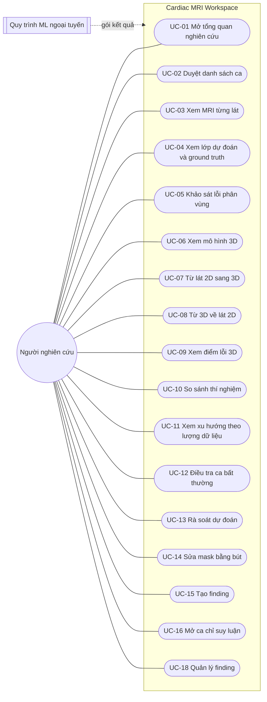
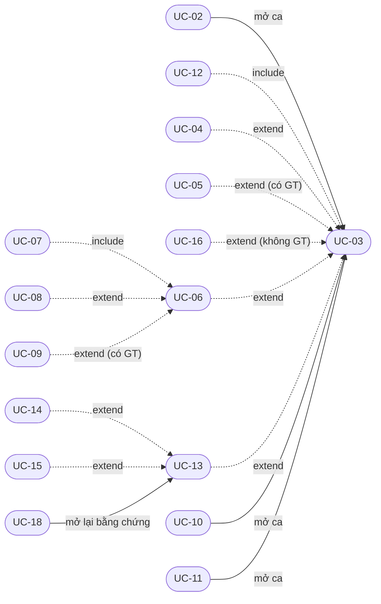

# 01 — Ca sử dụng

## 1. Tác nhân

- **Người nghiên cứu** (tác nhân chính): sinh viên hoặc người nghiên cứu ảnh y tế và AI, dùng app trên điện thoại
  Android. Mọi ca sử dụng dưới đây do tác nhân này khởi động.
- **Quy trình ML ngoại tuyến** (hệ thống ngoài): chạy trên máy có GPU, tạo các gói kết quả thí nghiệm (dự đoán, chỉ số,
  checksum) mà backend nạp và phục vụ. Không tương tác qua app.

Backend trên máy tính của nhóm là một phần của hệ thống, không phải tác nhân.

## 2. Biểu đồ UC tổng quát

Quan hệ giữa các ca sử dụng:

## 3. Danh sách ca sử dụng

| ID | Ca sử dụng | Màn hình | Người phụ trách | Mức | Trạng thái |
|---|---|---|---|---|---|
| UC-01 | Mở tổng quan nghiên cứu | SCR-01 | Bế Quốc Khánh | MUST | Đã có |
| UC-02 | Duyệt danh sách ca | SCR-02 | Phạm Tuấn Anh | MUST | Đã có |
| UC-03 | Xem MRI từng lát | SCR-03 | Phạm Tuấn Anh | MUST | Đã có |
| UC-04 | Xem lớp dự đoán và ground truth | SCR-03 | Phạm Tuấn Anh | MUST | Đã có |
| UC-05 | Khảo sát lỗi phân vùng | SCR-04 | Phạm Tuấn Anh | MUST | Đã có |
| UC-06 | Xem mô hình 3D | SCR-05 | Vũ Hùng Anh | MUST | Đã có |
| UC-07 | Từ lát 2D sang 3D | SCR-03, SCR-04 → SCR-05 | Vũ Hùng Anh | MUST | Đã có |
| UC-08 | Từ 3D về lát 2D | SCR-05 → SCR-03 | Vũ Hùng Anh | MUST | Đã có |
| UC-09 | Xem điểm lỗi 3D | SCR-05 | Vũ Hùng Anh | MUST | Đã có |
| UC-10 | So sánh thí nghiệm | SCR-07 | Bế Quốc Khánh | MUST | Đã có |
| UC-11 | Xem xu hướng theo lượng dữ liệu (25 / 50 / 100 %) | SCR-07 | Bế Quốc Khánh | MUST | Đã có (phần UNet: hướng phát triển) |
| UC-12 | Điều tra ca bất thường | SCR-01, SCR-02 → SCR-03, SCR-04 | Phạm Tuấn Anh | MUST | Đã có |
| UC-13 | Rà soát dự đoán | SCR-06 | Nguyễn Gia Đức Trung | MUST | Đã có |
| UC-14 | Sửa mask bằng bút | SCR-06 | Nguyễn Gia Đức Trung | MUST | Đã có |
| UC-15 | Tạo finding | SCR-06 → SCR-08 | Nguyễn Gia Đức Trung | MUST | Đã có |
| UC-16 | Mở ca chỉ suy luận | SCR-02 … SCR-06 | Phạm Tuấn Anh | MUST | Một phần: thiếu test rà soát / finding trên ca không GT |
| UC-17 | Yêu cầu chạy phân tích mới | — | Cả nhóm | SHOULD | Hướng phát triển |
| UC-18 | Quản lý finding | SCR-08 | Nguyễn Gia Đức Trung | SHOULD | Đã có |

## 4. Mô tả ngắn

**UC-01 Mở tổng quan nghiên cứu.** Tiền điều kiện: backend có study `STUDY_LA_001` (hoặc app ở chế độ FIXTURE).
Luồng chính: mở tab Study (màn hình gốc); app hiện tên và phiên bản bộ dữ liệu, thẻ số ca, thẻ finding (đang mở /
đã xử lý), Dice trung vị của từng cặp UNet–DINOv2 *chỉ khi server nói cặp đó so sánh được* (chip "Comparable"), 3 ca
Dice thấp nhất của mỗi thí nghiệm (do server chọn) dạng thanh nhỏ, ma trận thí nghiệm với phán quyết của server cho
từng phép so sánh. Từ đây mở danh sách ca, so sánh thí nghiệm, một ca bất thường (SCR-03) hoặc danh sách finding.
Nút "About this data" mở trang nguồn dữ liệu. Thay thế: dữ liệu thật chưa có UNet nên thẻ Dice ghi rõ chưa có cặp nào
so sánh được.

**UC-02 Duyệt danh sách ca.** Luồng chính: mở tab Cases; app liệt kê ca theo thứ tự server, mỗi dòng có mã ẩn danh
và nhãn chế độ (Evaluation / Inference & review). Người dùng tìm theo mã, lọc theo chế độ (trên trang đã tải), hoặc
chọn một thí nghiệm để mỗi ca có chip Dice của server ("no GT", "run failed", "not in …" ghi bằng chữ, không bao giờ là
0), sắp "Worst first" và thấy dấu "outlier n/3" do server chọn. Chạm một ca để mở SCR-03. Thay thế: mã gõ vào không có
trong trang đã tải thì có nút "Open <ID> directly".

**UC-03 Xem MRI từng lát.** Tiền điều kiện: ca tồn tại. Luồng chính: nếu ca có nhiều run, người dùng chọn run; chọn
biến thể dự đoán RAW hoặc PROCESSED (không có mặc định); chuyển lát bằng thanh trượt (kéo), nút ◀ ▶ (giữ để lặp),
−10 / +10, Play / Pause (khoảng 5 lát mỗi giây); chụm hai ngón để zoom, kéo một ngón để di ảnh, chạm đúp để zoom 2x
hoặc về vừa khung; nhãn "slice n / tổng (z = k)". Thay thế: ca chưa có run thì chỉ hiện MRI (và GT nếu có) kèm lý do.
Lỗi: thiếu lát → trạng thái "không có" với nút Refresh; dữ liệu sai (lát ngoài khoảng, sai kích thước, sai biến thể) →
chặn màn hình kèm mã tham chiếu; mất kết nối backend → lỗi khôi phục được với nút Retry.

**UC-04 Xem lớp dự đoán và ground truth.** Tiền điều kiện: đã chọn run và biến thể. Luồng chính: bật / tắt lớp dự
đoán và lớp GT (chỉ khi ca có GT), chọn độ mờ 25 / 50 / 75 / 100 %, kiểu vẽ Fill / Outline / Both, độ dày viền
1 / 2 / 3 px; đổi biến thể qua bộ chọn, không bao giờ tự đổi ngầm. Mask luôn khớp ảnh khi zoom / di.

**UC-05 Khảo sát lỗi phân vùng.** Tiền điều kiện: ca có GT và run thành công. Luồng chính: mở Error Inspector từ
SCR-03; app tô TP / FP / FN, hiện chỉ số của lát và của ca, danh sách lát tệ nhất theo thứ tự server; người dùng chạm
một lát để tới đó, chạm chú giải để ẩn / hiện một lớp lỗi, xem dòng "Matches / Differs from the server". Thay thế: ca
không có GT → nút bị khoá kèm giải thích, không có biểu đồ "lỗi bằng 0".

**UC-06 Xem mô hình 3D.** Tiền điều kiện: run thành công có lưới đã dựng. Luồng chính: mở SCR-05; app hiện bề mặt dự
đoán (đặc) và bề mặt GT (trong suốt) nếu có; xoay, zoom, di bằng cử chỉ; nút nhìn theo trục ±X / ±Y / ±Z và Fit; độ
mờ 30 / 60 / 100 % cho từng bề mặt; "Cut at slice" ẩn phần trên lát đang chọn.

**UC-07 Từ lát 2D sang 3D.** Luồng chính: từ SCR-03 hoặc SCR-04 bấm mở 3D; lát đang xem hiện thành một dải trên mô hình
3D. Một lát chọn trong 3D thay dải đó.

**UC-08 Từ 3D về lát 2D.** Luồng chính: chạm một điểm trên bề mặt; app tính ra số lát; bấm "Open in 2D" mở SCR-03 đúng
lát đó. Chạm vào nền không gây điều hướng.

**UC-09 Xem điểm lỗi 3D.** Tiền điều kiện: ca có GT và file hình học lỗi đã dựng. Luồng chính: mỗi vùng FN (chấm tròn)
và FP (ô vuông) liên thông là một điểm; chạm điểm → "FN, slices 11-13 (z = 10-12), 523 voxels" → "Open in 2D";
Previous / Next đi qua các vùng (hết FN rồi tới FP, mỗi loại vùng lớn trước).

**UC-10 So sánh thí nghiệm.** Luồng chính: mở tab Experiments (cả ma trận thí nghiệm) hoặc mở một phép so sánh từ
SCR-01 (chỉ các thí nghiệm của phép đó). SCR-07 liệt kê sáu phép so sánh cố định (UNet vs DINOv2 ở 25 / 50 / 100 %, xu
hướng của từng họ, DINOv2 thô vs hậu xử lý) kèm phán quyết của server; người dùng chọn chỉ số và thống kê (không mặc
định); với cặp so sánh được, app vẽ tóm tắt và hiệu số từng ca; chạm một ca để mở nó trong một run ở SCR-03. Thay thế:
thô vs hậu xử lý khác biến thể nên server ghi "không so sánh được" và app không vẽ hiệu số.

**UC-11 Xem xu hướng theo lượng dữ liệu.** Luồng chính: chọn xu hướng 25 → 50 → 100 % của một họ mô hình; app vẽ từng
ca, trung vị, khoảng q1–q3, chỉ nối các mức khi server cho phép; bảng ca của từng thí nghiệm có link mở ca. Dữ liệu
thật hiện có DINOv2; phần UNet nằm trong *Hướng phát triển*.

**UC-12 Điều tra ca bất thường.** Luồng chính: từ thanh ca Dice thấp ở SCR-01 hoặc dấu "outlier" ở SCR-02, mở ca ở
SCR-03 với run và biến thể của thí nghiệm đó; đi tiếp tới các lát tệ nhất ở SCR-04.

**UC-13 Rà soát dự đoán.** Tiền điều kiện: run thành công. Luồng chính: mở SCR-06 (chọn biến thể nếu đường dẫn chưa
có); review bắt đầu ở NOT_REVIEWED; người dùng chấp nhận (Accept) hoặc gắn cờ (Flag, bắt buộc ghi lý do); nút History
mở dòng thời gian ai, làm gì, lúc nào; có thể tạo finding từ lát đang xem ("New finding here").

**UC-14 Sửa mask bằng bút.** Luồng chính: chọn Add hoặc Erase, cỡ bút 1 / 3 / 5 / 7 / 11 px; một ngón vẽ, chế độ Pan
hoặc ngón thứ hai để di ảnh; Undo / Redo / Reset; giữ "Hold: source" để xem riêng mask gốc; Save tạo một phiên bản mask
mới bất biến. Quy tắc: dự đoán gốc không bao giờ bị ghi đè; GT không bao giờ là nguồn để sửa. Rời màn hình khi còn nét
chưa lưu, Reset hay Cancel đều hỏi xác nhận.

**UC-15 Tạo finding.** Luồng chính: từ SCR-06 bấm "New finding here"; form ở SCR-08 đã điền ca, run, biến thể, lát;
người dùng chọn loại (thiếu vùng, thừa vùng, lệch biên, mảnh rời, khác), viết ghi chú (tối đa 500 ký tự, cảnh báo nếu
giống thông tin cá nhân); lưu. Gắn finding với thí nghiệm, cohort hay một vùng vẽ trên ảnh: *Hướng phát triển*.

**UC-16 Mở ca chỉ suy luận.** Tiền điều kiện: ca ở chế độ INFERENCE_REVIEW (không có GT). Luồng chính: xem MRI, dự
đoán, mô hình 3D dự đoán, rà soát và sửa như ca thường; không có lớp GT, Dice / IoU, bản đồ FP / FN, điểm lỗi 3D hay
xếp hạng độ chính xác. Bảng chế độ:

| Khả năng | EVALUATION | INFERENCE_REVIEW |
|---|---|---|
| Xem MRI, lớp dự đoán, mô hình 3D dự đoán | Có | Có |
| Lớp GT, Dice / IoU, bản đồ FP / FN, điểm lỗi 3D | Có | Không |
| Sửa bằng bút, rà soát, finding | Có | Có |
| Xếp hạng độ chính xác trong cohort | Có, khi server nói so sánh được | Không (dòng WITHHELD, không có số) |

**UC-17 Yêu cầu chạy phân tích mới.** Backend có endpoint nhưng luôn trả `RUN_NOT_DEPLOYABLE`; app không có lối vào.
Thuộc *Hướng phát triển*.

**UC-18 Quản lý finding.** Luồng chính: mở tab Findings; danh sách mới nhất trước, lọc theo trạng thái và loại (có đếm);
"Open evidence" mở lại đúng ca / lát (hoặc SCR-07 nếu finding chỉ gắn thí nghiệm); "Review / correct" mở SCR-06 của
run đó; Resolve / Reopen; "Export PDF" in các
finding đang hiện.
