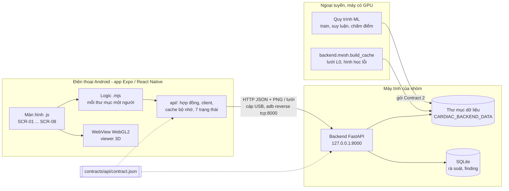

# 04 — Kiến trúc và công nghệ

## 1. Mô hình tổng thể

Kiến trúc **client – server cục bộ, kết quả tính sẵn**. Việc nặng (train, suy luận, dựng lưới 3D) làm **ngoại tuyến**
trên máy tính; lúc dùng app, backend chỉ đọc file đã kiểm checksum và trả về từng lát. Điện thoại chỉ hiển thị, tương
tác và gửi các thao tác rà soát.

Hai chế độ chạy của app:

- **LIVE**: app gọi backend thật ở địa chỉ đặt lúc build (`EXPO_PUBLIC_API_BASE_URL`); cấu hình của nhóm là
  `http://127.0.0.1:8000` qua `adb reverse tcp:8000 tcp:8000` (cáp USB), nên backend không mở ra mạng nào.
- **FIXTURE**: app không cần backend; dữ liệu được *sinh* từ hợp đồng API (`contracts/api/generate_fixture.py`), có
  bảng chọn kịch bản (ví dụ ma trận đủ UNet / DINOv2) để demo và test.

## 2. Thành phần

**App (`mobile/src/`)** — một cây mã, mỗi người một thư mục màn hình:

| Thư mục | Vai trò |
|---|---|
| `screens/v1-cases`, `v2-3d`, `v3-study`, `v4-review` | Màn hình của từng vertical; file `.js` chỉ vẽ, file `.mjs` quyết định và được `node --test` kiểm thẳng |
| `api/` | Hợp đồng (kiểm mọi phản hồi), client HTTP, 7 trạng thái màn hình, cache bộ nhớ, tải byte có kiểm SHA-256 |
| `lib/` | Toán zoom / di, mask, PNG, SHA-256, chế độ ca, privacy mode |
| `navigation/` | Bảng màn hình, 4 tab + ngăn xếp, header, ranh giới lỗi từng màn hình |
| `components/` | Thành phần dùng chung: khung trạng thái, thẻ Provenance, nhãn chế độ, lớp che phiên, token màu |

Test `registry.test.mjs` (G8) chặn một thư mục màn hình import thư mục màn hình khác.

**Backend (`backend/app/`)** — FastAPI, mã tương thích Python 3.9:

| Module | Vai trò |
|---|---|
| `routes/` (`cases`, `experiments`, `runs`, `reviews`, `findings`, `health`) | Mỗi endpoint của hợp đồng; lỗi trả theo mẫu chung của hợp đồng |
| `contract.py` | Nạp hợp đồng; backend từ chối khởi động nếu sai phiên bản |
| `cases.py`, `experiments.py`, `metrics.py`, `imaging.py` | Đọc dữ liệu đã nhập và gói kết quả, tính tổng hợp và so sánh, cắt lát PNG |
| `meshes.py` và `backend/mesh/` | Phục vụ lưới 3D và hình học lỗi đã dựng sẵn |
| `storage.py` | SQLite cho review, reviewed mask, finding (xem [05_du-lieu-csdl.md](05_du-lieu-csdl.md)) |
| `middleware.py`, `config.py` | Giới hạn thân request, log không có địa chỉ client, đường dẫn dữ liệu ngoài repo |

**Ngoại tuyến** — `ml/` (train, suy luận, hậu xử lý, chấm điểm, xuất gói Contract 2), `tools/` (chia dữ liệu, kiểm dữ
liệu, phiên đo trên điện thoại, luồng API end-to-end), `backend/mesh/build_cache.py` (dựng lưới và hình học lỗi).

## 3. Công nghệ và lý do chọn

| Lựa chọn | Lý do (chi tiết và số đo: `docs/DECISIONS.md`, `docs/RESULTS.md`) |
|---|---|
| React Native 0.86.3 + Expo SDK 57, JavaScript | Ứng viên duy nhất có số đo thật trên Galaxy A17: viewer 2D, zoom / di, bút, undo / redo, lưu / mở lại khớp từng pixel, chuyển lát p95 dưới 200 ms (DECISIONS 2) |
| Viewer 3D WebGL2 trong `react-native-webview` | Lưới L0 (61 424 tam giác) đạt FPS trung vị 59,88 và chạm → lát sai tối đa 1 lát; lưới giảm tam giác chạm sai tới 5–16 lát (DECISIONS 15) |
| Biểu diễn lỗi 3D: bề mặt dự đoán + một điểm cho mỗi vùng FP / FN (phương án 3) | Quyết định của trưởng nhóm 2026-11-14 (`backend/mesh/error_geometry.py`): điểm lỗi không bị bề mặt che, chạm được, dẫn thẳng tới dải lát; FPS trên máy với lớp lỗi chưa đo |
| `react-native-svg` | Vẽ mask, viền, biểu đồ V3 bằng vector, khớp toạ độ khi zoom |
| `expo-screen-capture`, `expo-print` | Privacy mode (chặn chụp màn hình) và xuất PDF finding; module native nên cần APK mới |
| Python + FastAPI + uvicorn | Cùng ngôn ngữ với phần ML; tự kiểm request theo kiểu; chạy được trên máy của nhóm (DECISIONS 4) |
| SQLite (thư viện chuẩn `sqlite3`) | Một file, không cần máy chủ CSDL; trigger chặn sửa / xoá bản đã lưu |
| Hợp đồng API dùng chung `contracts/api/contract.json` | Bốn người làm song song không lệch nhau; app chạy được ở FIXTURE khi chưa có backend (DECISIONS 5) |
| Mỗi lát là một PNG có địa chỉ theo sha256 | App kiểm SHA-256 trước khi dùng và cache lát đã xem; không tải cả khối (p50 trên 2 phút) (DECISIONS 16) |
| Cáp USB + `adb reverse` | Backend chỉ nghe `127.0.0.1`, không lộ ra mạng; không cần mạng overlay |
| `node --test`, render smoke (`react-test-renderer`), pytest, GitHub Actions | Kiểm đúng mã chạy trên điện thoại mà không cần điện thoại; mỗi job CI kiểm một việc |

## 4. Các vấn đề hiệu năng và cách giải quyết

- **Dữ liệu lớn trên điện thoại yếu**: không tải khối 3D; mỗi cử chỉ chỉ xin một lát (MRI tối đa khoảng 155 KB), lát
  đã xem trả từ bộ nhớ (0 byte mạng). Play chỉ xin lát kế khi lát trước đã hiện, không bao giờ hai lần tải song song.
- **Bút phải phản hồi ngay**: nét vẽ xử lý trên máy, không chờ mạng; chỉ khi lưu mới gửi các lát đã sửa.
- **3D mượt**: dựng lưới trước (ngoại tuyến), app chỉ tải byte đã kiểm checksum; WebView giải phóng bộ nhớ GPU khi rời
  màn hình.
- **Ghi đồng thời**: mỗi lần ghi gửi `expected_revision`; bản cũ bị từ chối (`STALE_REVISION`), không có "ghi sau thắng".
