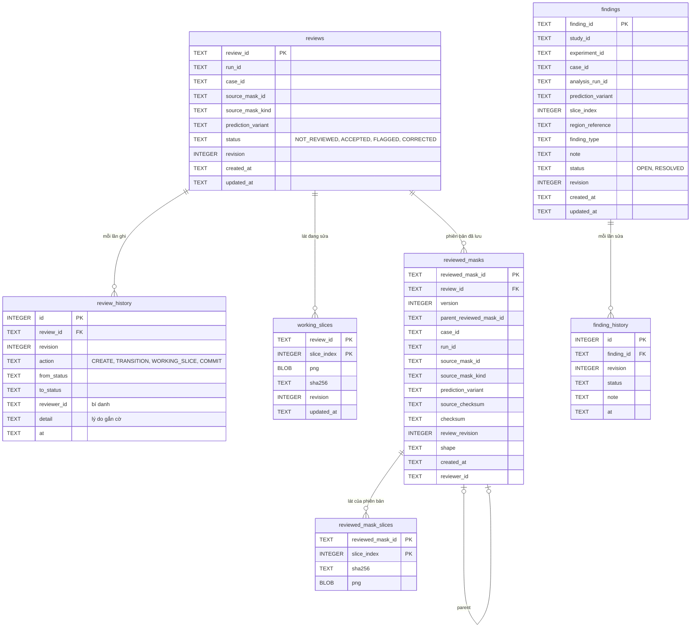

# 05 — Dữ liệu và cơ sở dữ liệu

## 1. Dữ liệu nguồn

- Bộ **LASC 2018**: 154 ca MRI tim 3D có mask nhĩ trái, đã ẩn danh; app dùng mã giả danh `CASE_0001` … `CASE_0154`.
  100 ca `Training Set` chia 80 train / 20 validation (seed 2024); 54 ca `Testing Set` là holdout khoá, chỉ dùng để
  chấm điểm một lần. Bước nhập (`python -m backend.app.ingest`) đưa vào 20 ca validation và 1 ca holdout chỉ suy
  luận; khi có biên bản mở holdout đã ký, nó thêm 53 ca holdout ở chế độ EVALUATION, tổng 74 ca.
- Một ca holdout (`CASE_0001`) được phục vụ ở chế độ INFERENCE_REVIEW: app không bao giờ nhận GT hay số đo theo ca của
  nó (dòng `WITHHELD`), nhưng nó vẫn được tính trong thống kê 54 ca.
- Header của bộ dữ liệu không có khoảng cách voxel thật, nên hình học là `GEOMETRY_NOT_VALIDATED` và không có mm hay mL.
  Toạ độ voxel `(x, y, z)` = (cột, hàng, lát), gốc ở pixel trên-trái, `slice_index = z`.

## 2. Hình thức lưu trữ

| Nơi | Lưu gì | Dạng |
|---|---|---|
| Thư mục dữ liệu ngoài repo (`CARDIAC_BACKEND_DATA`) | Mọi dữ liệu bệnh nhân và sản phẩm dẫn xuất | File; backend từ chối mọi đường dẫn nằm trong một git work tree |
| `data_cache/` | Kết quả nhập Contract 1: mỗi lát MRI / GT là một PNG, kèm siêu dữ liệu ca và hình học | PNG + JSON, có sha256 |
| `experiments/` | Gói kết quả Contract 2 của mỗi thí nghiệm: dự đoán RAW / PROCESSED, chỉ số từng ca, checksum, cấu hình | File + manifest; ca hỏng vẫn liệt kê là `FAILED` |
| `var/render_cache/` | Lát dự đoán cắt ra khi được hỏi lần đầu | PNG |
| `derived_meshes/` | Lưới 3D `cardiac-mesh/1` (`.cmesh`) và hình học lỗi `cardiac-error-geometry/1` (`.json`), dựng bởi `python -m backend.mesh.build_cache` | Ghi một lần, kiểm sha256 khi nạp và mỗi lần đọc |
| `var/backend.sqlite3` | Review, lịch sử, lát đang sửa, phiên bản reviewed mask, finding | SQLite (mục 3) |
| `logs/requests.jsonl` | Mỗi request một dòng: phương thức, route, mã trạng thái, thời gian, số byte, mã ẩn danh (ca, lát, run, review, thí nghiệm), digest sản phẩm | JSON lines, không có địa chỉ client, header hay thân request |

Danh mục study, ca, thí nghiệm và run **không** nằm trong SQLite: backend đọc chúng từ `data_cache/` và `experiments/`
lúc khởi động (đã kiểm checksum). Byte ảnh và lưới được phục vụ ở địa chỉ bất biến theo nội dung
`/api/v1/artifacts/<sha256>.png | .cmesh | .json` (xem [06_api.md](06_api.md)).

## 3. CSDL SQLite

Đọc từ `backend/app/storage.py`. Bảng có lịch sử và phiên bản là **chỉ thêm**: trigger từ chối UPDATE, DELETE và
REPLACE (lỗi `IMMUTABLE_ARTIFACT`). Mỗi lần sửa (PATCH, PUT một lát, commit) kiểm `expected_revision`
(`STALE_REVISION` nếu cũ); tạo review hay finding thì không cần.

Ràng buộc chính:

- `reviews`: duy nhất theo `(run_id, source_mask_id, prediction_variant)` — mỗi review gắn đúng một mask nguồn và một
  biến thể; nguồn chỉ là dự đoán RAW / PROCESSED, không bao giờ là GT.
- `reviewed_masks`: duy nhất theo `(review_id, version)`; không sửa, không xoá; `parent_reviewed_mask_id` nối phiên bản
  trước. Lưu (commit) ghi phiên bản mới, chuyển review sang CORRECTED và tăng revision trong cùng một giao dịch.
- `findings`: không bao giờ bị xoá; các cột bằng chứng (study, thí nghiệm, ca, run, biến thể, lát, vùng, loại) không đổi
  được; chỉ `note` và `status` đổi, mỗi lần ghi thêm một dòng `finding_history`.
- `run_id`, `case_id`, `experiment_id` là khoá logic tới danh mục đọc từ file (mục 2), không phải khoá ngoại SQLite.

## 4. Dữ liệu trên điện thoại

App **không ghi gì xuống bộ nhớ máy** (không file, không CSDL cục bộ); mọi thứ nằm trong RAM và mất khi tắt app:

| Bộ nhớ đệm | Giữ gì | Giới hạn |
|---|---|---|
| Cache phản hồi | Phản hồi thành công của 5 endpoint theo lát (MRI, dự đoán, GT, chỉ số lát, lát reviewed mask), khoá theo URL nên RAW và PROCESSED không lẫn | 600 mục; câu trả lời "không có" được nhớ 5 phút |
| Kho ảnh MRI | PNG đã kiểm SHA-256 | 48 ảnh |
| Kho mask | Mask đã giải mã để vẽ | 300 mask |
| Nhớ trong phiên | Biến thể đã chọn, kiểu vẽ mask, thí nghiệm và thứ tự của worklist | Chỉ chọn sẵn và nói rõ trên màn hình; lần đầu luôn hỏi |

"Clear cached images" (bảng About this screen và lớp che phiên) xoá các kho trên; bị từ chối khi một màn hình còn nét
sửa chưa lưu. WebView 3D chạy ẩn danh, không cache. Nét bút chưa lưu chỉ nằm trong bộ nhớ của SCR-06 cho tới khi Save.
