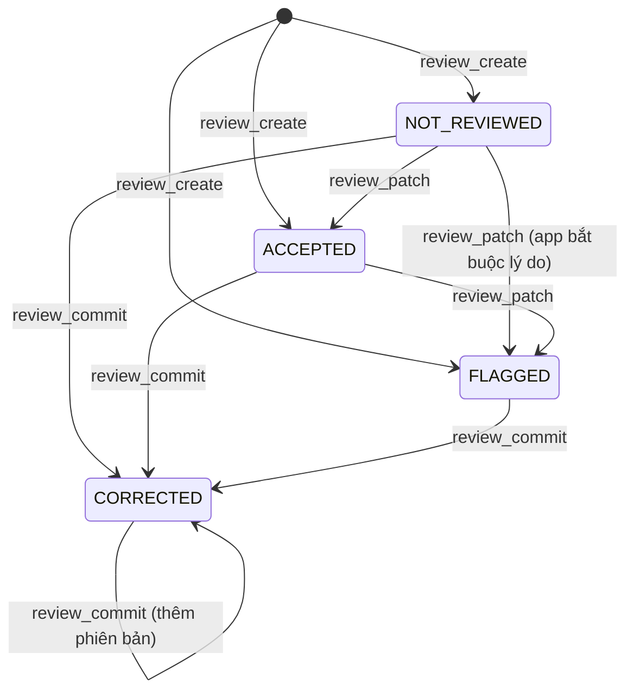

# 06 — API

Nguồn chuẩn là [`contracts/api/contract.json`](../../contracts/api/contract.json) (`api_contract_11`,
`contract_version`: **1.2.0**, kèm `schema.json` và `README.md` cùng thư mục). Trang này chỉ tóm tắt. Phiên bản 1.2.0
nằm trên nhánh `v4/trung-upgrades`; `main` còn ghim 1.1.0 cho tới khi gộp (1.2.0 chỉ thêm, không đổi gì của 1.1.0).
Phiên bản được ghim ở năm nơi và bước kiểm tra truy vết bắt chúng phải trùng nhau: `contract.json`, `schema.json`,
`backend/app/contract.py`, `mobile/src/api/contract.mjs`, `contracts/api/validate_api_contract.py`.

## 1. Quy tắc chung

| ID | Quy tắc | Người phụ trách | Mức | Trạng thái |
|---|---|---|---|---|
| API-01 | Mọi endpoint dưới `/api/v1`, siêu dữ liệu dạng JSON. Byte của lát (PNG 8 bit, đúng độ phân giải gốc), lưới (`.cmesh`) và hình học lỗi (`.json`) lấy từ địa chỉ bất biến theo nội dung `/api/v1/artifacts/<sha256>.<đuôi>`; byte phải băm ra đúng checksum trong phản hồi. `GET /health` (ngoài hợp đồng) trả trạng thái, phiên bản hợp đồng và hình học, số ca / thí nghiệm / run | Nguyễn Gia Đức Trung | MUST | Đã có |
| API-02 | Lỗi có mã máy ổn định và lời nhắn an toàn, dạng `{"error": {"code", "message", "request_id", "details"}}` (bảng mục 3) | Nguyễn Gia Đức Trung | MUST | Đã có |
| API-03 | Mọi thao tác ghi (PATCH, PUT, commit) gửi `expected_revision`; bản cũ bị từ chối `STALE_REVISION`; không có "ghi sau thắng" | Nguyễn Gia Đức Trung | MUST | Đã có |
| API-04 | Mọi sản phẩm mang hình học ghi `geometry_contract_version` và trạng thái hình học; lệch thì `GEOMETRY_MISMATCH`; fixture hình học chuẩn kiểm chính xác trong CI | Vũ Hùng Anh | MUST | Đã có |
| API-05 | Backend và app cùng kiểm phản hồi theo hợp đồng; dữ liệu FIXTURE sinh từ hợp đồng, không viết tay; app không tự đoán GT, chỉ số hay biến thể từ giá trị mặc định | Nguyễn Gia Đức Trung | MUST | Đã có |

## 2. Endpoint

Đường dẫn tính từ `/api/v1`. Tham số biến thể luôn là `RAW` hoặc `PROCESSED` (chữ hoa), không bao giờ có mặc định.

| ID | Phương thức và đường dẫn | Màn hình gọi | Ghi chú |
|---|---|---|---|
| EP-study_get | GET `/studies/{study_id}` | SCR-01 | Bộ dữ liệu (mã, tên, phiên bản), số ca theo chế độ, thí nghiệm, khả năng |
| EP-case_list | GET `/studies/{study_id}/cases` | SCR-02 | Có phân trang (`limit`, `page`), tìm `q`, lọc `mode`; mỗi dòng có `mode_capability` và `ground_truth_available` |
| EP-case_get | GET `/cases/{case_id}` | SCR-03 … SCR-06 | Chế độ, có GT không, hình học phẳng (kích thước, khoảng cách, gốc, hướng, quy ước chỉ số, phiên bản, `geometry_validation_status`), danh sách run |
| EP-mri_slice_get | GET `/cases/{case_id}/slices/{slice_index}/mri` | SCR-03, SCR-04, SCR-06 | Kiểm khoảng lát (`SLICE_OUT_OF_RANGE`); trả `content_url`, checksum |
| EP-ground_truth_slice_get | GET `/cases/{case_id}/slices/{slice_index}/ground-truth` | SCR-03, SCR-04, SCR-05 | Ca không GT trả `GROUND_TRUTH_UNAVAILABLE`, không bao giờ trả mask rỗng thay thế |
| EP-geometry_get | GET `/cases/{case_id}/geometry` | — (luồng API end-to-end) | Quy ước chỉ số, khoảng cách, gốc, hướng, phiên bản, trạng thái hình học |
| EP-experiment_list | GET `/experiments` | SCR-01, SCR-02, SCR-07 | Thí nghiệm đóng băng, biến thể dự đoán từng dòng, `evaluation_population` chung |
| EP-experiment_get | GET `/experiments/{experiment_id}` | SCR-03, SCR-07 | Họ mô hình, % dữ liệu, split / subset, phiên bản tiền / hậu xử lý, checkpoint, đánh giá |
| EP-experiment_metrics | GET `/experiments/{experiment_id}/metrics` | SCR-01, SCR-07 | Tóm tắt cohort từ chỉ số từng ca; N dự kiến, N thành công, biến thể, phiên bản chỉ số |
| EP-experiment_cases | GET `/experiments/{experiment_id}/cases` | SCR-01, SCR-02, SCR-07 | Từng ca: chỉ số hoặc trạng thái `FAILED` / `EXCLUDED` / `WITHHELD` kèm lý do; `outlier_selection` = 3 ca Dice 3D thấp nhất (server chọn) |
| EP-experiment_compare | GET `/experiments/compare?ids=…` | SCR-01, SCR-07 | Trả 200 với `comparable` true / false và lý do, quần thể chung, phiên bản chỉ số, biến thể, `summary` từng thí nghiệm trên quần thể chung; app làm theo phán quyết này |
| EP-analysis_run_create | POST `/cases/{case_id}/analysis-runs` | — | Luôn trả `RUN_NOT_DEPLOYABLE`: app chỉ xem kết quả tính sẵn |
| EP-analysis_run_get | GET `/analysis-runs/{run_id}` | SCR-03, SCR-05, SCR-06 | Trạng thái, lần chạy, cờ tính sẵn, mã mask RAW / PROCESSED, mã lưới, lý do lỗi |
| EP-analysis_run_metrics | GET `/analysis-runs/{run_id}/metrics?prediction_variant=…` | SCR-04 | Chỉ số ca, mã mask tham chiếu và dự đoán, danh sách lát tệ nhất (server xếp) |
| EP-analysis_slice_metrics | GET `/analysis-runs/{run_id}/slices/{slice_index}/metrics?prediction_variant=…` | SCR-03, SCR-04 | Dice / IoU một lát hoặc `NOT_APPLICABLE` theo luật lát rỗng |
| EP-analysis_slice_error | GET `/analysis-runs/{run_id}/slices/{slice_index}/error?prediction_variant=…` | — | Luôn trả `ARTIFACT_NOT_FOUND` (lý do `NO_ERROR_ARTIFACT`); SCR-04 tự tính TP / FP / FN từ lát dự đoán và lát GT |
| EP-prediction_slice_get | GET `/analysis-runs/{run_id}/slices/{slice_index}/prediction?variant=…` | SCR-03, SCR-04, SCR-06 | Đúng biến thể đã hỏi, không bao giờ thay ngầm |
| EP-reconstruction_get | GET `/analysis-runs/{run_id}/reconstruction?source_mask_id=…` | SCR-05 | `mesh_artifact_id` = `MESH_<sha256>`, byte ở `/artifacts/<sha256>.cmesh`; mã và loại mask nguồn, phiên bản hình học, phương pháp |
| EP-error_reconstruction_get | GET `/analysis-runs/{run_id}/error-reconstruction?prediction_variant=…` | SCR-05 | Chỉ khi có GT; `error_mesh_artifact_id` = `ERRGEOM_<sha256>`, file `cardiac-error-geometry/1` ở `/artifacts/<sha256>.json`: mỗi vùng FN / FP liên thông kèm dải lát và voxel đánh dấu |
| EP-review_create | POST `/analysis-runs/{run_id}/reviews` | SCR-06 | Thân: `status` (NOT_REVIEWED, ACCEPTED hoặc FLAGGED), `source_mask_id`, `prediction_variant`; nếu đã có review cùng run, nguồn, biến thể thì trả lại nó khi trạng thái hỏi là NOT_REVIEWED hoặc trùng trạng thái hiện tại, còn lại là `INVALID_REVIEW_TRANSITION` |
| EP-review_patch | PATCH `/reviews/{review_id}` | SCR-06 | Chuyển trạng thái hợp lệ, `expected_revision`, `reason` tuỳ chọn 1–500 ký tự (1.2.0); PATCH sang CORRECTED bị từ chối |
| EP-review_history_list | GET `/reviews/{review_id}/history` | SCR-06 | Mới thêm ở 1.2.0, chỉ đọc: mỗi lần ghi một dòng, cũ trước (CREATE, TRANSITION kèm lý do, WORKING_SLICE, COMMIT), bí danh và giờ UTC; không có byte mask |
| EP-working_mask_put | PUT `/reviews/{review_id}/working-mask/slices/{slice_index}` | SCR-06 | Một lát đã sửa, gắn đúng mask nguồn, `expected_revision`, phiên bản và trạng thái hình học; từ chối GT làm nguồn và hình học lệch |
| EP-review_commit | POST `/reviews/{review_id}/commit` | SCR-06 | Tạo phiên bản reviewed mask mới bất biến (mã, checksum, phiên bản), chuyển sang CORRECTED trong cùng giao dịch |
| EP-reviewed_masks_list | GET `/reviews/{review_id}/reviewed-masks` | SCR-06 | Các phiên bản và nguồn gốc của chúng |
| EP-reviewed_mask_slice_get | GET `/reviewed-masks/{reviewed_mask_id}/slices/{slice_index}` | SCR-06 | Một lát của một phiên bản, qua địa chỉ theo nội dung |
| EP-finding_create | POST `/findings` | SCR-08 | Study, thí nghiệm, ca, run, biến thể (bắt buộc khi có run), lát, loại, ghi chú (server nhận tối đa 4000 ký tự), vùng tuỳ chọn |
| EP-findings_list | GET `/findings` | SCR-01, SCR-08 | Cũ trước; lọc tuỳ chọn `case_id`, `analysis_run_id`, `experiment_id`, `status`, `finding_type` |
| EP-finding_patch | PATCH `/findings/{finding_id}` | SCR-08 | Chỉ sửa `note` và `status` (OPEN / RESOLVED), cần `expected_revision`; bằng chứng giữ nguyên |

## 3. Mã lỗi (API-02)

| Mã | HTTP | Khi nào |
|---|---|---|
| `CASE_NOT_FOUND` | 404 | Ca không tồn tại |
| `SLICE_OUT_OF_RANGE` | 422 | Chỉ số lát ngoài khối |
| `ARTIFACT_NOT_FOUND` | 404 | Sản phẩm không có (kể cả biến thể viết sai, ví dụ chữ thường) |
| `GROUND_TRUTH_UNAVAILABLE` | 404 | Dữ liệu cần GT của ca không có GT |
| `INVALID_REVIEW_TRANSITION` | 409 | Chuyển trạng thái review không hợp lệ (kể cả lặp lại trạng thái hiện tại) |
| `STALE_REVISION` | 409 | `expected_revision` cũ |
| `IMMUTABLE_ARTIFACT` | 409 | Ghi đè một phiên bản bất biến |
| `GEOMETRY_NOT_VALIDATED` | 422 | Thao tác cần hình học đã kiểm định |
| `GEOMETRY_MISMATCH` | 422 | Hình học gửi lên không khớp nguồn |
| `RUN_NOT_DEPLOYABLE` | 409 | Yêu cầu chạy phân tích mới |
| `RUN_NOT_SUCCEEDED` | 409 | Run chưa có kết quả thành công |
| `ANALYSIS_FAILED` | 422 | Run thất bại |
| `VALIDATION_ERROR` | 422 | Request sai dạng; thân quá 1 MiB (413) cũng dùng mẫu lỗi này |
| `NON_COMPARABLE_EXPERIMENTS` | 422 | Dành sẵn; `experiment_compare` hiện trả 200 với `comparable: false` |
| `UNAUTHORIZED` | 401 | Dành sẵn cho hồ sơ từ xa có đăng nhập; bản cục bộ không trả |

## 4. Trạng thái review

Không có review nghĩa là NOT_REVIEWED. "ACCEPTED" là người rà soát của dự án chấp nhận cho nghiên cứu, không phải xác
nhận lâm sàng.
