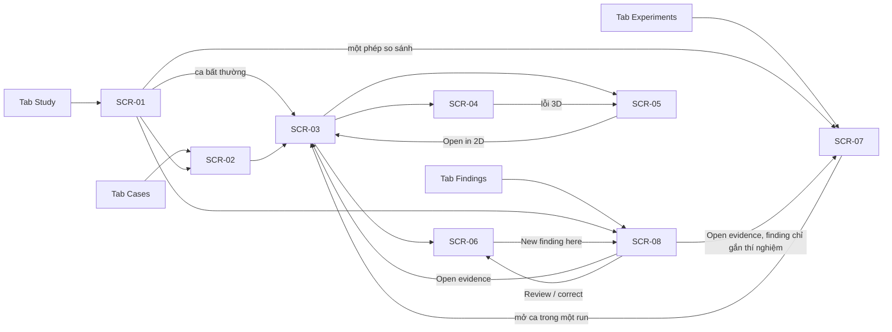

# 07 — Giao diện

Giao diện theo hướng thiết kế A **"Clinical viewer"**: nền gần đen, ảnh MRI là trung tâm, một màu nhấn xanh cho thứ
đang chọn, đường kẻ 1 dp thay cho khung. Khung app và SCR-02, SCR-03, SCR-04 đã theo hướng này trên `main`; các màn hình
còn lại đang được làm lại trên nhánh của từng người. Trang này mô tả **thành phần, trạng thái, thao tác và điều hướng**,
không mô tả màu hay bố cục pixel. Ở khung app và SCR-02, SCR-03, SCR-04, chữ trong ngoặc kép là nhãn đúng như app hiện.
App chỉ chạy màn hình dọc. Mỗi màn hình có một dòng chừa sẵn cho đường dẫn ảnh chụp cuối cùng (chụp trên APK gộp).

## 1. Danh sách màn hình và điều hướng

| ID | Màn hình | Vào từ | Người phụ trách | Mức | Trạng thái |
|---|---|---|---|---|---|
| SCR-01 | Study Overview | Tab Study (gốc) | Bế Quốc Khánh | MUST | Đã có |
| SCR-02 | Case List (worklist) | Tab Cases, SCR-01 | Phạm Tuấn Anh | MUST | Đã có |
| SCR-03 | Case Explorer (xem MRI 2D) | SCR-02, SCR-01, SCR-07, SCR-05, SCR-08 | Phạm Tuấn Anh | MUST | Đã có |
| SCR-04 | Error Inspector | SCR-03 | Phạm Tuấn Anh | MUST | Đã có |
| SCR-05 | 3D Inspector | SCR-03, SCR-04 | Vũ Hùng Anh | MUST | Đã có |
| SCR-06 | Review / Correction | SCR-03, SCR-08 | Nguyễn Gia Đức Trung | MUST | Đã có |
| SCR-07 | Experiment Comparison | Tab Experiments, SCR-01, SCR-08 | Bế Quốc Khánh | MUST | Đã có |
| SCR-08 | Findings | Tab Findings, SCR-01, SCR-06 | Nguyễn Gia Đức Trung | MUST | Đã có |
| SCR-09 | Trạng thái lượt chạy phân tích | — | Cả nhóm | SHOULD | Hướng phát triển |

Thành phần chung của mọi màn hình (khung app, Phạm Tuấn Anh):

- **Header** (56 dp): nút Back khi màn hình được mở từ màn hình khác; tên màn hình cho người đọc và dòng phụ
  "ca · run RUN · biến thể" (ở gốc một tab là "Study <mã study>"). Màn hình tự báo được tiêu đề, dòng phụ và nút riêng
  (`nav.setContext`); mã màn hình không hiện trên header. Bên phải: chỉ báo chế độ (một chấm và chữ "Live" hoặc
  "Fixture"), nút biểu tượng của màn hình (khiên privacy ở SCR-03, SCR-04), nút Info, và nút "more" khi màn hình có
  menu riêng.
- **Sheet Details** (nút Info): các mục của màn hình (mã, checksum, phiên bản, `z` của lát), rồi mục "This screen"
  ("Screen SCR-03 (V1)", "Mode LIVE · study …", "Contract …", "Build …") và nút "Clear cached images".
- **Chế độ FIXTURE**: chạm chữ "Fixture" mở bảng "Fixture scenarios" (chạm một endpoint để đổi kịch bản, "All default",
  "Close"); dưới header có banner "Generated contract fixtures: not patient data, not a backend. Tap Fixture to choose
  scenarios."
- **Khung viewer** (`CHROME.VIEWER`; trên `main` chỉ SCR-03 dùng): ảnh chiếm cả chiều cao, header nổi trên ảnh với một
  lớp tối phía trên, không có thanh tab. Ở LIVE header này không ghi chữ "Live"; ở FIXTURE vẫn ghi "Fixture" và không
  có banner.
- **Thanh 4 tab** dưới cùng: Study, Cases, Experiments, Findings, mỗi tab một biểu tượng và tên; tab đang chọn tô màu
  nhấn và có vạch ở mép trên. Tên tab rộng bằng cả tab, nằm trên một dòng và chỉ phóng tới 1,15 lần khi cỡ chữ hệ
  thống lớn, nên "Study" không bị cắt thành "Stud" ở 480 dp và "Experiments" vừa một phần tư màn hình 320 dp ở cỡ chữ 1,3. Nút Back (và phím back của Android) quay lại màn hình trước trong ngăn xếp.
- **7 trạng thái** dùng chung cho mọi vùng dữ liệu, tên trạng thái luôn viết thành chữ: đang tải (khung giữ chỗ,
  "Loading …"); đang xử lý ("Analysis is still running", không có phần trăm giả); thành công; không có dữ liệu
  ("Unavailable", nêu lý do); lỗi khôi phục được ("Something went wrong", nút "Retry"); dữ liệu sai bị chặn ("Cannot show
  this safely", kèm mã tham chiếu); bản cũ lệch phiên bản ("Version mismatch", nút "Refresh", không trộn dữ liệu hai
  run). Chi tiết thêm (mã HTTP, request id) gập dưới "Details (n)". Một màn hình lỗi khi vẽ chỉ chặn màn hình đó
  (`SCREEN_CRASHED`).
- **Bề ngang và cỡ chữ** (NFR-USAB-006): bố cục được kiểm ở 320, 384 (mặc định) và 480 dp, và ở cỡ chữ hệ thống 1,3.
  Nhãn một dòng trong ô cố định (tên tab, tên công cụ) rộng bằng ô chứa nó và chỉ phóng chữ tới 1,15 lần
  (`LABEL_FONT_CAP`, thẻ cạnh mã ca cũng vậy; mã ca và dòng phụ trong header nổi của khung viewer cũng vậy, vì Back và tới
  ba nút biểu tượng quanh chúng chiếm chỗ không đổi: ở 320 dp và cỡ chữ 1,3, "CASE_0029" không còn bị cắt thành
  "CASE_00…"); chip trên ảnh rộng bằng chữ của chính nó, không đặt ô cố định và không giới hạn phóng chữ, nên "TP 546 px"
  luôn đủ chữ; số (Dice, số đếm) nằm trên một dòng trong ô đủ rộng cho cỡ chữ 1,3; hàng
  nhãn rộng hơn màn hình (tab lọc của SCR-02) cuộn ngang; chữ thân bài phóng hết, mã thí nghiệm và mã khác chỉ hiện ở
  sheet Details.
- **Lớp che phiên**: sau 5 phút ở nền hoặc 10 phút không chạm, màn hình bị che ("Screen hidden") và phím back không làm
  gì; nút "Show the screen" hiện lại, nút "Clear cached images" xoá cache.
- **Vùng chạm**: ở thành phần dùng chung, khung app và SCR-02, SCR-03, SCR-04, mọi nút, chip và dòng chạm được cao ít
  nhất 48 dp (`MIN_TOUCH`); phần nhìn thấy thấp hơn thì vùng chạm được nới thêm (`hitSlopFor`).

## 2. Từng màn hình

### SCR-01 — Study Overview (Bế Quốc Khánh)

- **Mục đích**: nhìn cả nghiên cứu trong một màn hình và đi xuống bằng chứng.
- **Thành phần**: tên và phiên bản bộ dữ liệu; thẻ số ca; thẻ finding (đang mở / đã xử lý); thẻ Dice trung vị của từng
  cặp UNet–DINOv2 kèm chip "Comparable" / "Not compared" / "Not comparable" / "Not confirmed", chỉ hiện số khi server nói
  so sánh được; 3 ca Dice thấp nhất của mỗi thí nghiệm dạng thanh nhỏ (thứ tự của server); ma trận thí nghiệm và phán
  quyết của server cho từng phép so sánh; nút "About this data".
- **Trạng thái**: 7 trạng thái chung; dữ liệu thật chưa có UNet nên thẻ Dice ghi rõ chưa có cặp so sánh được.
- **Thao tác**: mở danh sách ca, mở một phép so sánh, mở danh sách finding; chạm thanh ca bất thường để mở ca đó.
- **Điều hướng**: SCR-02, SCR-07 (với các thí nghiệm của phép so sánh), SCR-08, SCR-03 (ca, run và biến thể do server
  nêu).
- Ảnh chụp màn hình: `docs/figures/screens/SCR-01.png` (chưa có).

### SCR-02 — Case List (Phạm Tuấn Anh)

- **Mục đích**: tìm ca, xếp ca theo Dice của một thí nghiệm và mở ca.
- **Thành phần**: ô tìm "Search case ID"; ba tab lọc "All", "Evaluation", "Inference & review", mỗi tab kèm số ca của
  trang đã tải (hàng tab cuộn ngang khi ba tab rộng hơn màn hình, ở 320 dp hoặc cỡ chữ 1,3, và có lề 16 dp ở hai đầu); nút "Dice of" ghi thí nghiệm theo tên người đọc ("DINOv2 100 % · Raw"), chạm mở sheet "Dice of" với
  "None (no Dice)" và các thí nghiệm, mỗi thí nghiệm một dòng ghi tên (không ghi mã thí nghiệm, mã chỉ nằm ở sheet Details); nút thứ tự "Server" / "Worst first"; tiêu đề cột
  "Case" và "Dice". Mỗi dòng ca cao 52 dp: mã ẩn danh, một thẻ ("Outlier n/3" là lựa chọn của server; "Mode unclear" khi
  chế độ và cờ GT mâu thuẫn; tên chế độ khi ca không phải Evaluation), thanh Dice và giá trị 3 chữ số (giá trị nằm trên một dòng, ô giá trị rộng đủ cho 5 ký tự ở cỡ chữ 1,3; màn hình hẹp
  thì thanh Dice co lại trước, mã ca và thẻ không bị cắt). Ca không có Dice
  ghi bằng chữ ("No GT", "Run failed", "Not in this experiment", "Excluded", "Dice not stated"), không bao giờ là 0. Với
  "Worst first", ca có Dice xếp từ thấp lên (bằng nhau thì nhiều FP + FN hơn trước, rồi theo mã ca), ca không có Dice
  nằm dưới tiêu đề "No Dice for this experiment" theo thứ tự server. Sheet Details: thí nghiệm, biến thể và phiên bản
  chỉ số của Dice, cách xếp "Worst first", nghĩa của "Outlier n/3", số ca của trang theo chế độ.
- **Mặc định**: khi người dùng chưa chọn, "Dice of" là thí nghiệm DINOv2 ở tỉ lệ dữ liệu lớn nhất server liệt kê, Raw
  trước Processed, và Details ghi "Chosen for you: …"; nếu câu trả lời của thí nghiệm đó không có Dice nào thì app chuyển
  sang thí nghiệm kế tiếp. "None (no Dice)" là lựa chọn riêng của người dùng. Thí nghiệm và thứ tự đã chọn giữ trong
  phiên.
- **Trạng thái**: 7 trạng thái chung cho danh sách ca. Một dòng ghi chú dưới nút khi không có Dice để hiện ("Choose an
  experiment to see each case's Dice.", "Loading the Dice of …", "Dice unavailable: …"); server trả giá trị của biến
  thể khác thì không hiện Dice ("Asked for …; the server answered with … values, so no Dice is shown."). Server còn trang
  sau thì cuối danh sách ghi "The server has more cases than this page (next_page is set). This build lists the first
  page only."; dòng không có `case_id` ghi "Row n: row has no case_id - not openable.".
- **Thao tác**: gõ tìm, chọn tab, chọn thí nghiệm, đổi thứ tự, kéo xuống để tải lại, chạm một ca; "Open <ID> directly"
  khi mã gõ vào không có trong trang đã tải.
- **Điều hướng**: SCR-03, kèm run và biến thể của thí nghiệm đang chọn khi ca có run trong thí nghiệm đó; không thì chỉ
  kèm mã ca.
- Ảnh chụp màn hình: `docs/figures/screens/SCR-02.png` (chưa có).

### SCR-03 — Case Explorer (Phạm Tuấn Anh)

- **Mục đích**: xem MRI từng lát với lớp dự đoán và GT.
- **Trước khi xem**: khi ca có nhiều run mà đường dẫn chưa nêu run, hoặc chưa có biến thể, app hiện màn chọn: mục
  "Analysis run" (danh sách run; run được hỏi mà ca không có thì ghi "The requested run is not one of this case's runs.
  Choose one of these:") và mục "Prediction variant" ("No default: choose which prediction to inspect. It stays on
  screen and never changes by itself.", chọn "Raw" hoặc "Processed"). Ca chỉ có một run thì mở luôn run đó; biến thể đã
  chọn trước đó trong phiên được chọn sẵn.
- **Thành phần** (khung viewer): ảnh MRI tràn màn hình, mở ở 1,6 lần vừa khung và ở lát giữa nếu đường dẫn không nêu
  lát. Header nổi: Back, mã ca, dòng phụ là tên thí nghiệm của run ("DINOv2 100 %", không ghi mã EXP-…; biến thể do panel dưới ghi) (ca có nhiều run thì dòng phụ có mũi tên, chạm để
  chọn lại run), khiên privacy, Info, "more". Mã ca và dòng phụ nằm một dòng và chỉ phóng tới 1,15 lần. Góc trái ghi "MRI" và chế độ ca ("Evaluation" / "Inference & review"); góc
  phải ghi "Slice Dice" và giá trị 3 chữ số hoặc một chữ ("Not applicable", "Unavailable"), "—" khi không có số. Chip
  lớp "Ground truth" (chỉ khi ca có GT) và "Prediction" (chỉ khi có run), cả hai bật sẵn; chip có biểu tượng mắt và ô
  màu, lớp mà lát này không có thì chip mờ đi. Thanh công cụ "Fill" / "Outline" / "Both" (mặc định "Fill"; tên mỗi nút nằm trên một dòng, rộng bằng nút 48 dp
  và chỉ phóng tới 1,15 lần, nên "Outline" và "Both" không bị cắt ở 320 và 480 dp). Panel dưới:
  "Prediction" với "Raw" / "Processed" (không có run thì ghi "No analysis run"), số lát "Slice 45 / 88" (đếm từ 1),
  thanh trượt có vạch mỗi 10 lát, và năm nút: lùi 10 lát, lát trước, Play / Pause, lát sau, tiến 10 lát. Hàng đầu của panel
  tự xuống dòng khi không đủ chỗ (320 dp ở cỡ chữ 1,3): số lát xuống một dòng riêng ở bên phải thay vì bị đẩy ra mép (trước
  đây chỉ thấy chữ "Slice"). Panel đo chiều cao của các hàng và báo lại, nên ảnh, chip lớp và thanh công cụ được đặt phía trên
  chiều cao đó (168 dp khi hàng đầu không xuống dòng). Khi zoom khác
  vừa khung và khác lúc mở, góc ảnh ghi mức zoom ("×2.0").
- **Sheet Tools** (nút "more"): mục "Open" có "Error inspector", "3D view", "Review and correct", mỗi dòng ghi nó mở gì
  hoặc vì sao đang khoá ("no ground truth for this case (Inference & review)", "needs an analysis run - …", "needs a
  succeeded run with a reconstruction", "needs this slice's prediction", "this slice did not load"); mục "Display" có
  "Outline width" 1 / 2 / 3 px, "Fill opacity" 25 / 50 / 75 / 100 %, nút "Fit to screen" và "Refresh this slice".
- **Sheet Details** (nút Info): "This slice" ("Slice 45 / 88 · z 44", dòng Dice kèm biến thể và phiên bản chỉ số, mã và
  checksum của MRI, dự đoán và GT, toạ độ lần chạm cuối), "Run" (run, họ mô hình, thí nghiệm, tính sẵn hay chạy mới),
  "Case and layers" (chế độ ca, lớp nào đang hiện và vì sao ẩn, ghi chú hình học chưa kiểm định), "Privacy", "Scripted
  runs".
- **Trạng thái**: ca chưa có run → chỉ MRI (và GT nếu có), dòng phụ "No analysis run", ba lối mở trong Tools khoá kèm lý
  do; lát lỗi hay không có → bảng trạng thái thay cho ảnh, không giữ số hay lớp của lát trước (Retry / Refresh chỉ tải
  lại lát đó); run đang chạy → "Analysis is still running" với "Refresh"; run thất bại → nút "View failure reason"; dữ
  liệu sai → chặn kèm mã; ảnh khác kích thước hình học → không vẽ lớp mask và ghi lý do; ảnh không tải được → nút "Fetch
  the image again"; FIXTURE không có pixel → vẽ lưới thay ảnh và ghi chú.
- **Thao tác**: kéo thanh trượt; nút bước (giữ lát trước / lát sau để lặp); lùi / tiến 10 lát; Play (khoảng 5 lát mỗi
  giây, dừng ở lát cuối; bấm Play ở lát cuối thì chạy lại từ lát 1); chụm hai ngón để zoom (từ vừa khung tới 16 lần,
  chụm vào dừng ở vừa khung), kéo một ngón để di, chạm đúp để zoom 2x / về vừa khung; chạm ảnh ghi toạ độ pixel nguồn
  vào Details; bật / tắt chip lớp; đổi biến thể; nhấn giữ số lát mở kịch bản đo A9 / L4 (công cụ đo hiệu năng).
- **Điều hướng**: SCR-04, SCR-05 (mở tại lát hiện tại), SCR-06, đều qua sheet Tools. Back về SCR-03 mở lại đúng run,
  biến thể và lát đang xem.
- Ảnh chụp màn hình: `docs/figures/screens/SCR-03.png` (chưa có).

### SCR-04 — Error Inspector (Phạm Tuấn Anh)

- **Mục đích**: xem dự đoán lệch GT ở đâu.
- **Thành phần**: header thường (tiêu đề "Error Inspector", dòng phụ "ca · biến thể", chỉ báo chế độ, khiên privacy,
  Info) và thanh tab. Ô ảnh vuông rộng hết màn hình: lát với lớp TP / FP / FN, mặc định vẽ cả phần tô và viền ("Both"),
  viền FP nét đứt; góc trái "Prediction" và "Raw vs ground truth" (hoặc "Processed …"); góc phải "Slice Dice"; chip
  "TP n px", "FP n px", "FN n px" (biểu tượng mắt, ô màu, ô của FP nét đứt; nhãn là một chuỗi rộng bằng chữ của nó, không
  ô cố định, nên "px" không bị cắt), chạm để ẩn / hiện lớp; thanh "Fill" /
  "Outline" / "Both". Panel: "Errors of" và biến thể, "Slice 45 / 88", thanh trượt và năm nút như SCR-03. Mục "Legend"
  (kèm số lát): mỗi lớp một dòng ("TP - agree", "FP - over-segmentation", "FN - missed", số pixel, "(hidden)" khi đang
  ẩn); dòng "Matches the server for this slice (…)" hoặc "Differs from the server for this slice: …"; cảnh báo khi mask
  đang vẽ không phải mask mà số của server nói tới (khi đó không so); "Fill opacity" 40 / 60 / 80 / 100 % và "Outline
  width" 1 / 2 / 3 px. Mục "Worst slices": tối đa 5 lát theo thứ tự server, lát đầu là nút "Jump to the worst slice" kèm
  dòng "Slice 53 / 88 · Dice 0.620 · FP 120 · FN 340", các lát sau ghi "#2" … "#5"; lát server nêu mà nằm ngoài khối thì
  vẫn liệt kê nhưng không mở ("outside this volume (z 0..87) - not opened"). Mục "Error profile" ("FP + FN per slice"): mỗi lát có GT một cột, lát không có GT không có
  cột (không phải 0), lát đang xem có viền; chạm một cột để mở lát đó. Mục "Case metrics": Dice, IoU, "Volume error"
  (RVE, %) của cả ca và dòng "FP … · FN … voxels". Nút "3D error view".
- **Sheet Details**: "This slice" (số lát kèm `z`, dòng Dice, mã mask tham chiếu và dự đoán), "Run" (run và biến thể,
  phiên bản chỉ số ca, luật và phiên bản chọn lát tệ), "Where the numbers come from" (chỉ số ca, lát tệ và biểu đồ là của
  server; số pixel TP / FP / FN đếm trên điện thoại từ hai mask đang vẽ), "Privacy".
- **Trạng thái**: ca không có GT → bảng "Unavailable" và câu "… so there is no disagreement, metric or worst slice to
  show - not zero."; số của server cho biến thể khác → mục lát tệ ghi "Cannot show this safely", không có lát tệ, biểu
  đồ hay chỉ số ca; luật hoặc phiên bản chọn lát tệ khác bản mà hợp đồng ghim → không liệt kê lát nào, ghi lý do
  (`SELECTION_RULE_UNSUPPORTED`, `SELECTION_VERSION_UNSUPPORTED`); lát lỗi → bảng trạng thái thay ảnh, không giữ lớp,
  số hay mã của lát trước, nút "3D error view" khoá ("this slice did not load"); 7 trạng thái chung.
- **Thao tác**: chạm "Jump to the worst slice", một dòng lát tệ hoặc một cột biểu đồ để tới lát đó; chuyển lát, Play;
  ẩn / hiện lớp lỗi; đổi kiểu vẽ, độ mờ, độ dày viền; chụm để zoom, kéo để di, chạm đúp.
- **Điều hướng**: "3D error view" mở SCR-05 tại lát hiện tại, lớp lỗi bật sẵn; chỉ truyền ca, run, biến thể và lát, không
  có tham số nào SCR-05 bỏ qua.
- Ảnh chụp màn hình: `docs/figures/screens/SCR-04.png` (chưa có).

### SCR-05 — 3D Inspector (Vũ Hùng Anh)

- **Mục đích**: xem hình 3D nhĩ trái, lỗi 3D, và nhảy về đúng lát 2D.
- **Thành phần**: dòng "Run … · prediction … · L0 surface (undecimated)"; WebView 3D với bề mặt dự đoán (đặc), bề mặt GT
  (trong suốt) và điểm lỗi (FN chấm tròn, FP ô vuông) kèm chú giải và số đếm; dải lát hiện tại; trục voxel ở góc; hàng
  công tắc từng lớp và độ mờ 30 / 60 / 100 % cho hai bề mặt, số tam giác mỗi lớp; nút ±X / ±Y / ±Z, Fit, "Cut at slice",
  Previous / Next; thẻ vùng chọn với "Open in 2D".
- **Trạng thái**: không có lưới → báo lý do; ca không GT → không có lớp GT và điểm lỗi; thiếu file lỗi → bề mặt vẫn hiện,
  hàng "Errors" ghi lý do; ghi chú hình học chưa kiểm định (không mm, không hướng giải phẫu).
- **Thao tác**: xoay, zoom, di; chạm bề mặt hoặc điểm lỗi để chọn; Previous / Next qua các vùng (hết FN rồi FP, vùng lớn
  trước); cắt tại lát; đổi góc nhìn.
- **Điều hướng**: "Open in 2D" → SCR-03 tại lát đã chọn (chỉ khi bấm).
- Ảnh chụp màn hình: `docs/figures/screens/SCR-05.png` (chưa có).

### SCR-06 — Review / Correction (Nguyễn Gia Đức Trung)

- **Mục đích**: chấp nhận, gắn cờ hoặc sửa mask dự đoán mà không ghi đè bản gốc.
- **Thành phần**: câu hỏi "Which prediction do you want to review?" khi đường dẫn chưa nêu biến thể (RAW / PROCESSED);
  trạng thái review và nguồn (mã mask, biến thể); nút Accept và Flag (hộp lý do bắt buộc, bộ đếm ký tự, cảnh báo riêng
  tư, nút "Flag anyway"); nút ‹ › chuyển lát với nhãn "slice z / tổng" (z đếm từ 0); vùng ảnh: mask nguồn vẽ thành
  viền, nét sửa trong suốt bên trên, vòng tròn bút ở ngón tay và dòng "Add · 5 px at x, y"; thanh công cụ Brush / Pan, Add / Erase, cỡ bút 1 / 3 / 5 / 7 / 11 px, Undo / Redo / Reset,
  − / Fit / +; nút giữ "Hold: source"; History; "Cancel edits", Save; "New finding here". Ở FIXTURE, mask thay thế ghi rõ
  SYNTHETIC.
- **Trạng thái**: đang lưu / đã lưu ("SAVED"); "Continuing from version …" khi review đã CORRECTED; bản cũ lệch revision
  → Refresh, không ghi đè; 7 trạng thái chung.
- **Thao tác**: một ngón vẽ; Pan hoặc ngón thứ hai để di; rời màn hình khi còn nét chưa lưu, Reset, Cancel đều hỏi xác
  nhận; Save hỏi "Save correction?" rồi tạo phiên bản mới.
- **Điều hướng**: SCR-08 (form finding đã điền ca, run, biến thể, lát); Back về màn hình trước.
- Ảnh chụp màn hình: `docs/figures/screens/SCR-06.png` (chưa có).

### SCR-07 — Experiment Comparison (Bế Quốc Khánh)

- **Mục đích**: so sánh thí nghiệm theo đúng phán quyết của server.
- **Thành phần**: mở từ tab là cả ma trận thí nghiệm, mở từ SCR-01 là các thí nghiệm của một phép so sánh; thẻ
  "Comparisons (server verdicts)" liệt kê sáu phép so sánh cố định (UNet vs DINOv2 ở 25 / 50 / 100 %; xu hướng UNet; xu
  hướng DINOv2; DINOv2 100 % thô vs hậu xử lý) kèm phán quyết, lý do, quần thể chung; bộ chọn chỉ số và thống kê
  (median / mean), không mặc định, kèm chú giải chỉ số (HD95 và mL khoá); mỗi ô: mô hình, biến thể, mức tổng hợp, quần
  thể, N; biểu đồ giá trị từng ca theo chỉ số đã chọn (UNet chấm tròn, DINOv2 tam giác, vòng quanh 3 ca thấp nhất); biểu đồ hiệu số từng ca cho cặp so sánh được; biểu đồ xu hướng
  25 → 50 → 100 % (từng ca, trung vị, q1–q3, chỉ nối khi server cho phép); bảng ca của mỗi thí nghiệm kể cả FAILED /
  EXCLUDED / WITHHELD có lý do; nút "About this data".
- **Trạng thái**: chưa chọn chỉ số thì không vẽ gì; cặp không so sánh được thì ghi lý do, không vẽ hiệu số; thí nghiệm
  không có dữ liệu ghi "not available to compare".
- **Thao tác**: chọn chỉ số, thống kê; chạm một điểm hay một dòng để mở ca ("Open in <run>", "Open this case (SCR-03)").
- **Điều hướng**: SCR-03 (ca, run, biến thể).
- Ảnh chụp màn hình: `docs/figures/screens/SCR-07.png` (chưa có).

### SCR-08 — Findings (Nguyễn Gia Đức Trung)

- **Mục đích**: ghi và quản lý phát hiện gắn bằng chứng.
- **Thành phần**: khi mở từ SCR-06: form tạo finding (loại, ghi chú tối đa 500 ký tự với bộ đếm và cảnh báo riêng tư,
  nút "Create anyway"); danh sách mới nhất trước ("n of m shown · newest first") với ca, lát, run, biến thể, loại, trạng
  thái; chip lọc trạng thái và loại có đếm; mỗi finding có "Open evidence", Resolve / Reopen, "Review / correct" (khi có
  run); nút "Export PDF".
- **Trạng thái**: 7 trạng thái chung; APK chưa có `expo-print` thì nút PDF tắt và nói rõ.
- **Thao tác**: tạo, lọc, đánh dấu đã xử lý / mở lại, mở bằng chứng, xuất PDF.
- **Điều hướng**: SCR-03 (bằng chứng ca / lát), SCR-07 (finding chỉ gắn thí nghiệm), SCR-06.
- Ảnh chụp màn hình: `docs/figures/screens/SCR-08.png` (chưa có).

### SCR-09 — Trạng thái lượt chạy phân tích

Không xây trong bản này (app không yêu cầu chạy phân tích mới); xem *Hướng phát triển* ở
[02_yeu-cau-chuc-nang.md](02_yeu-cau-chuc-nang.md).
