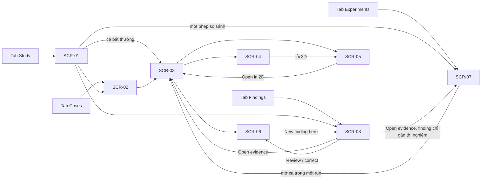

# 07 — Giao diện

Giao diện theo hướng thiết kế A **"Clinical viewer"**; phần làm lại hình thức đang nằm trên các nhánh, nên trang này mô
tả **thành phần, trạng thái, thao tác và điều hướng**, không mô tả màu hay bố cục pixel. App chỉ chạy màn hình dọc.
Mỗi màn hình có một dòng chừa sẵn cho đường dẫn ảnh chụp cuối cùng (chụp trên APK gộp).

## 1. Danh sách màn hình và điều hướng

| ID | Màn hình | Vào từ | Người phụ trách | Mức | Trạng thái |
|---|---|---|---|---|---|
| SCR-01 | Study Overview | Tab Study (gốc) | Bế Quốc Khánh | MUST | Đã có |
| SCR-02 | Case List (worklist) | Tab Cases, SCR-01 | Phạm Tuấn Anh | MUST | Đã có |
| SCR-03 | Case Explorer (xem MRI 2D) | SCR-02, SCR-01, SCR-07, SCR-05, SCR-08 | Phạm Tuấn Anh | MUST | Đã có |
| SCR-04 | Error Inspector | SCR-03 | Phạm Tuấn Anh | MUST | Đã có |
| SCR-05 | 3D Inspector | SCR-03, SCR-04 | Vũ Hùng Anh | MUST | Đã có |
| SCR-06 | Review / Correction | SCR-03, SCR-08 | Nguyễn Gia Đức Trung | MUST | Đã có |
| SCR-07 | Experiment Comparison | Tab Experiments, SCR-01, SCR-08 | Bế Quốc Khánh | MUST | Đã có |
| SCR-08 | Findings | Tab Findings, SCR-01, SCR-06 | Nguyễn Gia Đức Trung | MUST | Đã có |
| SCR-09 | Trạng thái lượt chạy phân tích | — | Cả nhóm | SHOULD | Hướng phát triển |

Thành phần chung của mọi màn hình (khung app, Phạm Tuấn Anh):

- **Header**: tên màn hình và dòng phụ "ca · run · biến thể"; chạm tiêu đề mở **About this screen** (mã màn hình, chế
  độ, phiên bản hợp đồng, bản build, nút "Clear cached images"). Huy hiệu **FIXTURE** hoặc **LIVE**; ở FIXTURE có banner
  và bảng chọn kịch bản.
- **Thanh 4 tab** dưới cùng: Study, Cases, Experiments, Findings; nút Back quay lại màn hình trước trong ngăn xếp.
- **7 trạng thái** dùng chung cho mọi vùng dữ liệu: đang tải; đang xử lý (không có phần trăm giả); thành công; không có
  dữ liệu (nêu lý do, nút Refresh nếu hợp lý); lỗi khôi phục được (nút Retry); dữ liệu sai bị chặn (kèm mã tham chiếu);
  bản cũ lệch phiên bản (nút Refresh, không trộn dữ liệu hai run). Một màn hình lỗi khi vẽ chỉ chặn màn hình đó.
- **Lớp che phiên**: sau 5 phút ở nền hoặc 10 phút không chạm, màn hình bị che, chạm để hiện lại; có nút xoá cache.

## 2. Từng màn hình

### SCR-01 — Study Overview (Bế Quốc Khánh)

- **Mục đích**: nhìn cả nghiên cứu trong một màn hình và đi xuống bằng chứng.
- **Thành phần**: tên và phiên bản bộ dữ liệu; thẻ số ca; thẻ finding (đang mở / đã xử lý); thẻ Dice trung vị của từng
  cặp UNet–DINOv2 kèm chip "Comparable" / "Not compared" / "Not comparable" / "Not confirmed", chỉ hiện số khi server nói
  so sánh được; 3 ca Dice thấp nhất của mỗi thí nghiệm dạng thanh nhỏ (thứ tự của server); ma trận thí nghiệm và phán
  quyết của server cho từng phép so sánh; nút "About this data".
- **Trạng thái**: 7 trạng thái chung; dữ liệu thật chưa có UNet nên thẻ Dice ghi rõ chưa có cặp so sánh được.
- **Thao tác**: mở danh sách ca, mở một phép so sánh, mở danh sách finding; chạm thanh ca bất thường để mở ca đó.
- **Điều hướng**: SCR-02, SCR-07 (với các thí nghiệm của phép so sánh), SCR-08, SCR-03 (ca, run và biến thể do server
  nêu).
- Ảnh chụp màn hình: `docs/figures/screens/SCR-01.png` (chưa có).

### SCR-02 — Case List (Phạm Tuấn Anh)

- **Mục đích**: tìm và chọn ca.
- **Thành phần**: ô tìm theo mã; bộ lọc chế độ All / Evaluation / Inference & review; dòng ca có mã ẩn danh và nhãn
  chế độ; chip chọn thí nghiệm (None hoặc một thí nghiệm kèm biến thể); khi chọn, mỗi dòng có chip Dice của server
  ("no GT", "run failed", "not in …" bằng chữ, không bao giờ 0) và dấu "outlier n/3"; nút "Server order" / "Worst first".
- **Trạng thái**: 7 trạng thái chung; cảnh báo nếu chế độ và cờ GT của một ca mâu thuẫn.
- **Thao tác**: gõ tìm, lọc, chọn thí nghiệm, đổi thứ tự, chạm một ca; "Open <ID> directly" khi mã gõ vào không có
  trong trang đã tải.
- **Điều hướng**: SCR-03 (kèm run và biến thể của thí nghiệm đang chọn, nếu có).
- Ảnh chụp màn hình: `docs/figures/screens/SCR-02.png` (chưa có).

### SCR-03 — Case Explorer (Phạm Tuấn Anh)

- **Mục đích**: xem MRI từng lát với lớp dự đoán và GT.
- **Thành phần**: bộ chọn run (khi có nhiều) và bộ chọn biến thể RAW / PROCESSED ("No default"); vùng ảnh với lớp
  "Prediction (RAW)" hoặc "(PROCESSED)" và lớp "Ground truth" (chỉ khi có GT); độ mờ 25 / 50 / 75 / 100 %; kiểu vẽ Fill /
  Outline / Both, viền 1 / 2 / 3 px; nút Fit; công tắc Privacy mode (bật sẵn); nhãn "slice n / tổng (z = k)"; thanh lát
  với ◀ ▶ (giữ để lặp), −10 / +10, Play / Pause; Dice của lát khi hợp lệ; dòng run, mô hình, thí nghiệm và cờ "tính sẵn";
  toạ độ pixel nguồn khi chạm ảnh; thẻ "Provenance (this slice)" gập sẵn; nút "Error inspector (SCR-04)", "3D (SCR-05)",
  "Review / correct (SCR-06)".
- **Trạng thái**: ca chưa có run → chỉ MRI (và GT) kèm lý do, ba nút trên bị khoá; thiếu lát → "không có" + Refresh;
  dữ liệu sai → chặn kèm mã; mất kết nối → Retry. Ca không GT: nút SCR-04 khoá kèm giải thích.
- **Thao tác**: kéo thanh lát, nút bước, Play; chụm để zoom, kéo một ngón để di, chạm đúp zoom 2x / vừa khung; nhấn giữ
  nhãn lát mở kịch bản đo A9 / L4 (công cụ đo hiệu năng).
- **Điều hướng**: SCR-04, SCR-05 (mở tại lát hiện tại), SCR-06.
- Ảnh chụp màn hình: `docs/figures/screens/SCR-03.png` (chưa có).

### SCR-04 — Error Inspector (Phạm Tuấn Anh)

- **Mục đích**: xem dự đoán lệch GT ở đâu.
- **Thành phần**: lát với lớp TP / FP / FN (FP viền nét đứt), chú giải TP / FP / FN chạm để ẩn / hiện; chỉ số lát và
  chỉ số ca; danh sách lát tệ nhất theo thứ tự server và thanh lỗi từng lát; dòng "Matches / Differs from the server";
  cùng thanh lát, kiểu vẽ, Privacy mode và thẻ Provenance như SCR-03; nút mở lỗi 3D.
- **Trạng thái**: chỉ mở được khi ca có GT và run thành công; 7 trạng thái chung.
- **Thao tác**: chạm một lát tệ để tới đó, chuyển lát, ẩn / hiện lớp lỗi.
- **Điều hướng**: SCR-05 tại lát hiện tại, lớp lỗi bật sẵn.
- Ảnh chụp màn hình: `docs/figures/screens/SCR-04.png` (chưa có).

### SCR-05 — 3D Inspector (Vũ Hùng Anh)

- **Mục đích**: xem hình 3D nhĩ trái, lỗi 3D, và nhảy về đúng lát 2D.
- **Thành phần**: dòng "Run … · prediction … · L0 surface (undecimated)"; WebView 3D với bề mặt dự đoán (đặc), bề mặt GT
  (trong suốt) và điểm lỗi (FN chấm tròn, FP ô vuông) kèm chú giải và số đếm; dải lát hiện tại; trục voxel ở góc; hàng
  công tắc từng lớp và độ mờ 30 / 60 / 100 % cho hai bề mặt, số tam giác mỗi lớp; nút ±X / ±Y / ±Z, Fit, "Cut at slice",
  Previous / Next; thẻ vùng chọn với "Open in 2D".
- **Trạng thái**: không có lưới → báo lý do; ca không GT → không có lớp GT và điểm lỗi; thiếu file lỗi → bề mặt vẫn hiện,
  hàng "Errors" ghi lý do; ghi chú hình học chưa kiểm định (không mm, không hướng giải phẫu).
- **Thao tác**: xoay, zoom, di; chạm bề mặt hoặc điểm lỗi để chọn; Previous / Next qua các vùng (hết FN rồi FP, vùng lớn
  trước); cắt tại lát; đổi góc nhìn.
- **Điều hướng**: "Open in 2D" → SCR-03 tại lát đã chọn (chỉ khi bấm).
- Ảnh chụp màn hình: `docs/figures/screens/SCR-05.png` (chưa có).

### SCR-06 — Review / Correction (Nguyễn Gia Đức Trung)

- **Mục đích**: chấp nhận, gắn cờ hoặc sửa mask dự đoán mà không ghi đè bản gốc.
- **Thành phần**: câu hỏi "Which prediction do you want to review?" khi đường dẫn chưa nêu biến thể (RAW / PROCESSED);
  trạng thái review và nguồn (mã mask, biến thể); nút Accept và Flag (hộp lý do bắt buộc, bộ đếm ký tự, cảnh báo riêng
  tư, nút "Flag anyway"); nút ‹ › chuyển lát với nhãn "slice z / tổng" (z đếm từ 0); vùng ảnh: mask nguồn vẽ thành
  viền, nét sửa trong suốt bên trên, vòng tròn bút ở ngón tay và dòng "Add · 5 px at x, y"; thanh công cụ Brush / Pan, Add / Erase, cỡ bút 1 / 3 / 5 / 7 / 11 px, Undo / Redo / Reset,
  − / Fit / +; nút giữ "Hold: source"; History; "Cancel edits", Save; "New finding here". Ở FIXTURE, mask thay thế ghi rõ
  SYNTHETIC.
- **Trạng thái**: đang lưu / đã lưu ("SAVED"); "Continuing from version …" khi review đã CORRECTED; bản cũ lệch revision
  → Refresh, không ghi đè; 7 trạng thái chung.
- **Thao tác**: một ngón vẽ; Pan hoặc ngón thứ hai để di; rời màn hình khi còn nét chưa lưu, Reset, Cancel đều hỏi xác
  nhận; Save hỏi "Save correction?" rồi tạo phiên bản mới.
- **Điều hướng**: SCR-08 (form finding đã điền ca, run, biến thể, lát); Back về màn hình trước.
- Ảnh chụp màn hình: `docs/figures/screens/SCR-06.png` (chưa có).

### SCR-07 — Experiment Comparison (Bế Quốc Khánh)

- **Mục đích**: so sánh thí nghiệm theo đúng phán quyết của server.
- **Thành phần**: mở từ tab là cả ma trận thí nghiệm, mở từ SCR-01 là các thí nghiệm của một phép so sánh; thẻ
  "Comparisons (server verdicts)" liệt kê sáu phép so sánh cố định (UNet vs DINOv2 ở 25 / 50 / 100 %; xu hướng UNet; xu
  hướng DINOv2; DINOv2 100 % thô vs hậu xử lý) kèm phán quyết, lý do, quần thể chung; bộ chọn chỉ số và thống kê
  (median / mean), không mặc định, kèm chú giải chỉ số (HD95 và mL khoá); mỗi ô: mô hình, biến thể, mức tổng hợp, quần
  thể, N; biểu đồ giá trị từng ca theo chỉ số đã chọn (UNet chấm tròn, DINOv2 tam giác, vòng quanh 3 ca thấp nhất); biểu đồ hiệu số từng ca cho cặp so sánh được; biểu đồ xu hướng
  25 → 50 → 100 % (từng ca, trung vị, q1–q3, chỉ nối khi server cho phép); bảng ca của mỗi thí nghiệm kể cả FAILED /
  EXCLUDED / WITHHELD có lý do; nút "About this data".
- **Trạng thái**: chưa chọn chỉ số thì không vẽ gì; cặp không so sánh được thì ghi lý do, không vẽ hiệu số; thí nghiệm
  không có dữ liệu ghi "not available to compare".
- **Thao tác**: chọn chỉ số, thống kê; chạm một điểm hay một dòng để mở ca ("Open in <run>", "Open this case (SCR-03)").
- **Điều hướng**: SCR-03 (ca, run, biến thể).
- Ảnh chụp màn hình: `docs/figures/screens/SCR-07.png` (chưa có).

### SCR-08 — Findings (Nguyễn Gia Đức Trung)

- **Mục đích**: ghi và quản lý phát hiện gắn bằng chứng.
- **Thành phần**: khi mở từ SCR-06: form tạo finding (loại, ghi chú tối đa 500 ký tự với bộ đếm và cảnh báo riêng tư,
  nút "Create anyway"); danh sách mới nhất trước ("n of m shown · newest first") với ca, lát, run, biến thể, loại, trạng
  thái; chip lọc trạng thái và loại có đếm; mỗi finding có "Open evidence", Resolve / Reopen, "Review / correct" (khi có
  run); nút "Export PDF".
- **Trạng thái**: 7 trạng thái chung; APK chưa có `expo-print` thì nút PDF tắt và nói rõ.
- **Thao tác**: tạo, lọc, đánh dấu đã xử lý / mở lại, mở bằng chứng, xuất PDF.
- **Điều hướng**: SCR-03 (bằng chứng ca / lát), SCR-07 (finding chỉ gắn thí nghiệm), SCR-06.
- Ảnh chụp màn hình: `docs/figures/screens/SCR-08.png` (chưa có).

### SCR-09 — Trạng thái lượt chạy phân tích

Không xây trong bản này (app không yêu cầu chạy phân tích mới); xem *Hướng phát triển* ở
[02_yeu-cau-chuc-nang.md](02_yeu-cau-chuc-nang.md).
