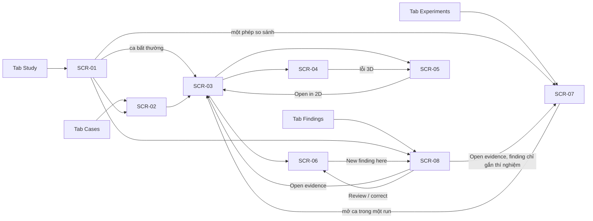

# 07 — Giao diện

Giao diện theo hướng thiết kế A **"Clinical viewer"**: nền gần đen, ảnh MRI là trung tâm, một màu nhấn xanh cho thứ
đang chọn, đường kẻ 1 dp thay cho khung. Khung app và SCR-02, SCR-03, SCR-04 đã theo hướng này trên `main`, SCR-06 và
SCR-08 trên nhánh V4; các màn hình còn lại đang được làm lại trên nhánh của từng người. Trang này mô tả **thành phần,
trạng thái, thao tác và điều hướng**, không mô tả màu hay bố cục pixel. Ở khung app và SCR-02, SCR-03, SCR-04, SCR-06,
SCR-08, chữ trong ngoặc kép là nhãn đúng như app hiện. App chỉ chạy màn hình dọc. Mỗi màn hình có một dòng chừa sẵn cho đường dẫn ảnh chụp cuối cùng (chụp trên APK gộp).

## 1. Danh sách màn hình và điều hướng

| ID | Màn hình | Vào từ | Người phụ trách | Mức | Trạng thái |
|---|---|---|---|---|---|
| SCR-01 | Study Overview | Tab Study (gốc) | Bế Quốc Khánh | MUST | Đã có |
| SCR-02 | Case List (worklist) | Tab Cases, SCR-01 | Phạm Tuấn Anh | MUST | Đã có |
| SCR-03 | Case Explorer (xem MRI 2D) | SCR-02, SCR-01, SCR-07, SCR-05, SCR-08 | Phạm Tuấn Anh | MUST | Đã có |
| SCR-04 | Error Inspector | SCR-03 | Phạm Tuấn Anh | MUST | Đã có |
| SCR-05 | 3D Inspector | SCR-03, SCR-04 | Vũ Hùng Anh | MUST | Đã có |
| SCR-06 | Review / Correction | SCR-03, SCR-08 | Nguyễn Gia Đức Trung | MUST | Đã có |
| SCR-07 | Experiment Comparison | Tab Experiments, SCR-01, SCR-08 | Bế Quốc Khánh | MUST | Đã có |
| SCR-08 | Findings | Tab Findings, SCR-01, SCR-06 | Nguyễn Gia Đức Trung | MUST | Đã có |
| SCR-09 | Trạng thái lượt chạy phân tích | — | Cả nhóm | SHOULD | Hướng phát triển |

Thành phần chung của mọi màn hình (khung app, Phạm Tuấn Anh):

- **Header** (56 dp): nút Back khi màn hình được mở từ màn hình khác; tên màn hình cho người đọc và dòng phụ
  là mã ca (ở gốc một tab là "Study <mã study>"). Màn hình tự báo được tiêu đề, dòng phụ và nút riêng
  (`nav.setContext`), ví dụ SCR-03 ghi tên thí nghiệm "DINOv2 100 %", SCR-04 ghi "ca · biến thể"; mã màn hình và mã run
  không hiện trên header, kể cả lúc màn hình đang tải (vòng 8 thấy "CASE_0029 · run RUN_EXP-D-100_…" trong khoảng nửa giây
  lúc SCR-04 tải, nay dòng phụ mặc định chỉ là mã ca). SCR-04 báo dòng phụ và khiên privacy cho header ngay từ khung đầu,
  kể cả lúc đang tải, nên header không xô lệch khi ca tải xong (vòng 8 thấy khiên hiện muộn đẩy "Live" sang trái và
  thoáng hiện "Error Insp…"); khi chỗ cho tiêu đề vẫn hẹp lại, dòng được vẽ ngay ở cỡ ước lượng từ bề rộng đã đo. Bên phải: chỉ báo chế độ (một chấm và chữ "Live" hoặc
  "Fixture"), nút biểu tượng của màn hình (khiên privacy ở SCR-03, SCR-04), nút Info, và nút "more" khi màn hình có
  menu riêng.
- **Sheet Details** (nút Info): các mục của màn hình (mã, checksum, phiên bản, `z` của lát), rồi mục "This screen"
  ("Screen SCR-03 (V1)", "Mode LIVE · study …", "Contract …", "Build …") và nút "Clear cached images".
- **Chế độ FIXTURE**: chạm chữ "Fixture" mở bảng "Fixture scenarios" (chạm một endpoint để đổi kịch bản, "All default",
  "Close"); dưới header có banner "Generated contract fixtures: not patient data, not a backend. Tap Fixture to choose
  scenarios."
- **Khung viewer** (`CHROME.VIEWER`; SCR-03 và SCR-06 dùng): ảnh chiếm cả chiều cao, header nổi trên ảnh với một
  lớp tối phía trên, không có thanh tab. Ở LIVE header này không ghi chữ "Live"; ở FIXTURE vẫn ghi "Fixture" và không
  có banner.
- **Thanh 4 tab** dưới cùng: Study, Cases, Experiments, Findings, mỗi tab một biểu tượng và tên; tab đang chọn tô màu
  nhấn và có vạch ở mép trên. Tên tab rộng bằng cả tab, nằm trên một dòng và chỉ phóng tới 1,15 lần khi cỡ chữ hệ
  thống lớn, nên "Study" không bị cắt thành "Stud" ở 480 dp và "Experiments" vừa một phần tư màn hình 320 dp ở cỡ chữ 1,3. Nút Back (và phím back của Android) quay lại màn hình trước trong ngăn xếp.
- **7 trạng thái** dùng chung cho mọi vùng dữ liệu, tên trạng thái luôn viết thành chữ: đang tải (khung giữ chỗ,
  "Loading …"); đang xử lý ("Analysis is still running", không có phần trăm giả); thành công; không có dữ liệu
  ("Unavailable", nêu lý do); lỗi khôi phục được ("Something went wrong", nút "Retry"); dữ liệu sai bị chặn ("Cannot show
  this safely", kèm mã tham chiếu); bản cũ lệch phiên bản ("Version mismatch", nút "Refresh", không trộn dữ liệu hai
  run). Chi tiết thêm (mã HTTP, request id) gập dưới "Details (n)". Một màn hình lỗi khi vẽ chỉ chặn màn hình đó
  (`SCREEN_CRASHED`).
- **Bề ngang và cỡ chữ** (NFR-USAB-006): bố cục được kiểm ở 320, 384 (mặc định) và 480 dp, và ở cỡ chữ hệ thống 1,3.
  Nhãn một dòng trong ô cố định (tên tab, tên công cụ) rộng bằng ô chứa nó và chỉ phóng chữ tới 1,15 lần
  (`LABEL_FONT_CAP`, thẻ cạnh mã ca cũng vậy; tên màn hình và dòng phụ trong mọi header cũng vậy, cả header thường lẫn header nổi của khung viewer, vì Back, chữ "Live" và tới
  ba nút biểu tượng quanh chúng chiếm chỗ không đổi: ở 320 dp và cỡ chữ 1,3, "CASE_0029" không còn bị cắt thành
  "CASE_00…"; hai dòng đó còn tự đo bề rộng chữ và vẽ nhỏ lại cho vừa trước khi bị cắt: mỗi dòng có một bản chữ ẩn (cùng kiểu chữ, không
  giới hạn số dòng, không nhìn thấy, trình đọc màn hình bỏ qua) cho bề rộng thật của dòng qua `onTextLayout`, hộp tiêu đề cho chỗ
  có sẵn qua `onLayout`, và cỡ chữ giảm từng 0,5 sp, mỗi cỡ đo lại, đến khi dòng vừa chỗ trừ 1 dp, tối thiểu 0,6 lần với tên và
  0,75 lần với dòng phụ (`BAR_TEXT_MIN_SCALE`); chỉ khi ở mức tối thiểu vẫn không vừa thì dòng mới bị cắt bằng "…". Mỗi lần đổi
  chữ, chỗ có sẵn hoặc cỡ chữ hệ thống chỉ đo lại cho tới khi chốt cỡ, rồi không đo nữa (không dùng `adjustsFontSizeToFit` của
  Text vì Android không co chữ: phiên 2026-11-15 vòng 7 vẫn thấy "Error Insp…"; vòng 8 thấy SCR-04 vẫn bị cắt vì cách đo
  này lúc đó chỉ bật cho header nổi, mà SCR-04 dùng header thường). Ở 320 dp chỗ giữa Back và "Live" chỉ 96 dp
  (89 dp ở cỡ chữ 1,3) mà "Error Inspector" cần 117 dp (134 dp ở mức giới hạn 1,15), nên tiêu đề SCR-04 cần co còn nhiều nhất khoảng
  0,82 (0,67 ở cỡ chữ 1,3) lần cỡ của nó; app lấy bậc 0,5 sp lớn nhất mà dòng còn vừa, theo số đo của điện thoại là 13,5 sp
  (11 sp ở cỡ chữ 1,3) thay vì 17 sp, nên không thành "Error Insp…", và dòng phụ "CASE_0029 · Raw" đủ chữ thay vì "CASE_0029…" (9,5 sp ở cỡ chữ 1,3); dòng phụ có mũi tên của bộ chọn
  run trừ 14 dp cho mũi tên và khoảng hở; tên màn hình vẫn là "Error Inspector", khớp mục
  Tools và các tài liệu này); chip trên ảnh rộng bằng chữ của chính nó, không đặt ô cố định và không giới hạn phóng chữ, nên "TP 546 px"
  luôn đủ chữ; số (Dice, số đếm) nằm trên một dòng trong ô đủ rộng cho cỡ chữ 1,3, và mã ca trong danh sách có hàng thanh
  (lowest-Dice của SCR-01) nằm trong ô có `minWidth` chứ không có bề rộng cố định, nên không bị cắt thành "CASE_00…" ở cỡ chữ 1,3; hàng
  nhãn rộng hơn màn hình (tab lọc của SCR-02) cuộn ngang, và dưới 360 dp khoảng cách giữa các tab là 16 dp thay vì 24 dp để ở
  320 dp, cỡ chữ 1,0 tab thứ ba nằm trọn trong màn hình, cách mép 13 dp lúc nghỉ (trước đây nó vượt mép 3 dp và chữ số cuối chạm
  mép); chữ thân bài phóng hết, mã thí nghiệm và mã khác chỉ hiện ở
  sheet Details.
- **Lớp che phiên**: sau 5 phút ở nền hoặc 10 phút không chạm, màn hình bị che ("Screen hidden") và phím back không làm
  gì; nút "Show the screen" hiện lại, nút "Clear cached images" xoá cache.
- **Vùng chạm**: ở thành phần dùng chung, khung app và SCR-02, SCR-03, SCR-04, SCR-06, SCR-08, mọi nút, chip và dòng chạm
  được cao ít nhất 48 dp (`MIN_TOUCH`); phần nhìn thấy thấp hơn thì vùng chạm được nới thêm (`hitSlopFor`).

## 2. Từng màn hình

### SCR-01 — Study Overview (Bế Quốc Khánh)

- **Mục đích**: nhìn cả nghiên cứu trong một màn hình và đi xuống bằng chứng.
- **Thành phần**: tên và phiên bản bộ dữ liệu; thẻ số ca; thẻ finding (đang mở / đã xử lý); thẻ Dice trung vị của từng
  cặp UNet–DINOv2 kèm chip "Comparable" / "Not compared" / "Not comparable" / "Not confirmed", chỉ hiện số khi server nói
  so sánh được; 3 ca Dice thấp nhất của mỗi thí nghiệm dạng thanh nhỏ (thứ tự của server); ma trận thí nghiệm và phán
  quyết của server cho từng phép so sánh; nút "About this data".
- **Trạng thái**: 7 trạng thái chung; dữ liệu thật chưa có UNet nên thẻ Dice ghi rõ chưa có cặp so sánh được.
- **Thao tác**: mở danh sách ca, mở một phép so sánh, mở danh sách finding; chạm thanh ca bất thường để mở ca đó.
- **Điều hướng**: SCR-02, SCR-07 (với các thí nghiệm của phép so sánh), SCR-08, SCR-03 (ca, run và biến thể do server
  nêu).
- Ảnh chụp màn hình: `docs/figures/screens/SCR-01.png` (chưa có).

### SCR-02 — Case List (Phạm Tuấn Anh)

- **Mục đích**: tìm ca, xếp ca theo Dice của một thí nghiệm và mở ca.
- **Thành phần**: ô tìm "Search case ID"; ba tab lọc "All", "Evaluation", "Inference & review", mỗi tab kèm số ca của
  trang đã tải (hàng tab cuộn ngang khi ba tab rộng hơn màn hình, ở 320 dp hoặc cỡ chữ 1,3, và có lề 16 dp ở hai đầu; dưới 360 dp khoảng cách giữa các tab là 16 dp thay vì 24 dp, nên ở 320 dp, cỡ chữ 1,0 ba tab nằm trọn trong màn hình với lề ở đầu cuối); nút "Dice of" ghi thí nghiệm theo tên người đọc ("DINOv2 100 % · Raw"), chạm mở sheet "Dice of" với
  "None (no Dice)" và các thí nghiệm, mỗi thí nghiệm một dòng ghi tên (không ghi mã thí nghiệm, mã chỉ nằm ở sheet Details); nút thứ tự "Server" / "Worst first"; tiêu đề cột
  "Case" và "Dice". Mỗi dòng ca cao 52 dp: mã ẩn danh, một thẻ ("Outlier n/3" là lựa chọn của server; "Mode unclear" khi
  chế độ và cờ GT mâu thuẫn; tên chế độ khi ca không phải Evaluation), thanh Dice và giá trị 3 chữ số (giá trị nằm trên một dòng, ô giá trị rộng đủ cho 5 ký tự ở cỡ chữ 1,3; màn hình hẹp
  thì thanh Dice co lại trước, mã ca và thẻ không bị cắt). Ca không có Dice
  ghi bằng chữ ("No GT", "Run failed", "Not in this experiment", "Excluded", "Dice not stated"), không bao giờ là 0. Với
  "Worst first", ca có Dice xếp từ thấp lên (bằng nhau thì nhiều FP + FN hơn trước, rồi theo mã ca), ca không có Dice
  nằm dưới tiêu đề "No Dice for this experiment" theo thứ tự server. Sheet Details: thí nghiệm, biến thể và phiên bản
  chỉ số của Dice, cách xếp "Worst first", nghĩa của "Outlier n/3", số ca của trang theo chế độ.
- **Mặc định**: khi người dùng chưa chọn, "Dice of" là thí nghiệm DINOv2 ở tỉ lệ dữ liệu lớn nhất server liệt kê, Raw
  trước Processed, và Details ghi "Chosen for you: …"; nếu câu trả lời của thí nghiệm đó không có Dice nào thì app chuyển
  sang thí nghiệm kế tiếp. "None (no Dice)" là lựa chọn riêng của người dùng. Thí nghiệm và thứ tự đã chọn giữ trong
  phiên.
- **Trạng thái**: 7 trạng thái chung cho danh sách ca. Một dòng ghi chú dưới nút khi không có Dice để hiện ("Choose an
  experiment to see each case's Dice.", "Loading the Dice of …", "Dice unavailable: …"); server trả giá trị của biến
  thể khác thì không hiện Dice ("Asked for …; the server answered with … values, so no Dice is shown."). Server còn trang
  sau thì cuối danh sách ghi "The server has more cases than this page (next_page is set). This build lists the first
  page only."; dòng không có `case_id` ghi "Row n: row has no case_id - not openable.".
- **Thao tác**: gõ tìm, chọn tab, chọn thí nghiệm, đổi thứ tự, kéo xuống để tải lại, chạm một ca; "Open <ID> directly"
  khi mã gõ vào không có trong trang đã tải.
- **Điều hướng**: SCR-03, kèm run và biến thể của thí nghiệm đang chọn khi ca có run trong thí nghiệm đó; không thì chỉ
  kèm mã ca.
- Ảnh chụp màn hình: `docs/figures/screens/SCR-02.png` (chưa có).

### SCR-03 — Case Explorer (Phạm Tuấn Anh)

- **Mục đích**: xem MRI từng lát với lớp dự đoán và GT.
- **Trước khi xem**: khi ca có nhiều run mà đường dẫn chưa nêu run, hoặc chưa có biến thể, app hiện màn chọn: mục
  "Analysis run" (danh sách run; run được hỏi mà ca không có thì ghi "The requested run is not one of this case's runs.
  Choose one of these:") và mục "Prediction variant" ("No default: choose which prediction to inspect. It stays on
  screen and never changes by itself.", chọn "Raw" hoặc "Processed"). Ca chỉ có một run thì mở luôn run đó; biến thể đã
  chọn trước đó trong phiên được chọn sẵn.
- **Thành phần** (khung viewer): ảnh MRI tràn màn hình, mở ở 1,6 lần vừa khung và ở lát giữa nếu đường dẫn không nêu
  lát. Header nổi: Back, mã ca, dòng phụ là tên thí nghiệm của run ("DINOv2 100 %", không ghi mã EXP-…; biến thể do panel dưới ghi) (ca có nhiều run thì dòng phụ có mũi tên, chạm để
  chọn lại run), khiên privacy, Info, "more". Mã ca và dòng phụ nằm một dòng và chỉ phóng tới 1,15 lần. Góc trái ghi "MRI" và chế độ ca ("Evaluation" / "Inference & review"); góc
  phải ghi "Slice Dice" và giá trị 3 chữ số hoặc một chữ ("Not applicable", "Unavailable"), "—" khi không có số. Chip
  lớp "Ground truth" (chỉ khi ca có GT) và "Prediction" (chỉ khi có run), cả hai bật sẵn; chip có biểu tượng mắt và ô
  màu, lớp mà lát này không có thì chip mờ đi. Thanh công cụ "Fill" / "Outline" / "Both" (mặc định "Fill"; tên mỗi nút nằm trên một dòng, rộng bằng nút 48 dp
  và chỉ phóng tới 1,15 lần, nên "Outline" và "Both" không bị cắt ở 320 và 480 dp). Panel dưới:
  "Prediction" với "Raw" / "Processed" (không có run thì ghi "No analysis run"), số lát "Slice 45 / 88" (đếm từ 1),
  thanh trượt có vạch mỗi 10 lát, và năm nút: lùi 10 lát, lát trước, Play / Pause, lát sau, tiến 10 lát. Hàng đầu của panel
  tự xuống dòng khi không đủ chỗ (320 dp ở cỡ chữ 1,3): số lát xuống một dòng riêng ở bên phải thay vì bị đẩy ra mép (trước
  đây chỉ thấy chữ "Slice"). Panel đo chiều cao của các hàng và báo lại, nên ảnh, chip lớp và thanh công cụ được đặt phía trên
  chiều cao đó (168 dp khi hàng đầu không xuống dòng). Khi zoom khác
  vừa khung và khác lúc mở, góc ảnh ghi mức zoom ("×2.0").
- **Sheet Tools** (nút "more"): mục "Open" có "Error inspector", "3D view", "Review and correct", mỗi dòng ghi nó mở gì
  hoặc vì sao đang khoá ("no ground truth for this case (Inference & review)", "needs an analysis run - …", "needs a
  succeeded run with a reconstruction", "needs this slice's prediction", "this slice did not load"); mục "Display" có
  "Outline width" 1 / 2 / 3 px, "Fill opacity" 25 / 50 / 75 / 100 %, nút "Fit to screen" và "Refresh this slice".
- **Sheet Details** (nút Info): "This slice" ("Slice 45 / 88 · z 44", dòng Dice kèm biến thể và phiên bản chỉ số, mã và
  checksum của MRI, dự đoán và GT, toạ độ lần chạm cuối), "Run" (run, họ mô hình, thí nghiệm, tính sẵn hay chạy mới),
  "Case and layers" (chế độ ca, lớp nào đang hiện và vì sao ẩn, ghi chú hình học chưa kiểm định), "Privacy", "Scripted
  runs".
- **Trạng thái**: ca chưa có run → chỉ MRI (và GT nếu có), dòng phụ "No analysis run", ba lối mở trong Tools khoá kèm lý
  do; lát lỗi hay không có → bảng trạng thái thay cho ảnh, không giữ số hay lớp của lát trước (Retry / Refresh chỉ tải
  lại lát đó); run đang chạy → "Analysis is still running" với "Refresh"; run thất bại → nút "View failure reason"; dữ
  liệu sai → chặn kèm mã; ảnh khác kích thước hình học → không vẽ lớp mask và ghi lý do; ảnh không tải được → nút "Fetch
  the image again"; FIXTURE không có pixel → vẽ lưới thay ảnh và ghi chú.
- **Thao tác**: kéo thanh trượt; nút bước (giữ lát trước / lát sau để lặp); lùi / tiến 10 lát; Play (khoảng 5 lát mỗi
  giây, dừng ở lát cuối; bấm Play ở lát cuối thì chạy lại từ lát 1); chụm hai ngón để zoom (từ vừa khung tới 16 lần,
  chụm vào dừng ở vừa khung), kéo một ngón để di, chạm đúp để zoom 2x / về vừa khung; chạm ảnh ghi toạ độ pixel nguồn
  vào Details; bật / tắt chip lớp; đổi biến thể; nhấn giữ số lát mở kịch bản đo A9 / L4 (công cụ đo hiệu năng).
- **Điều hướng**: SCR-04, SCR-05 (mở tại lát hiện tại), SCR-06, đều qua sheet Tools. Back về SCR-03 mở lại đúng run,
  biến thể và lát đang xem.
- Ảnh chụp màn hình: `docs/figures/screens/SCR-03.png` (chưa có).

### SCR-04 — Error Inspector (Phạm Tuấn Anh)

- **Mục đích**: xem dự đoán lệch GT ở đâu.
- **Thành phần**: header thường (tiêu đề "Error Inspector", dòng phụ "ca · biến thể", chỉ báo chế độ, khiên privacy,
  Info) và thanh tab. Ô ảnh vuông rộng hết màn hình: lát với lớp TP / FP / FN, mặc định vẽ cả phần tô và viền ("Both"),
  viền FP nét đứt; góc trái "Prediction" và "Raw vs ground truth" (hoặc "Processed …"); góc phải "Slice Dice"; chip
  "TP n px", "FP n px", "FN n px" (biểu tượng mắt, ô màu, ô của FP nét đứt; nhãn là một chuỗi rộng bằng chữ của nó, không
  ô cố định, nên "px" không bị cắt), chạm để ẩn / hiện lớp; thanh "Fill" /
  "Outline" / "Both". Panel: "Errors of" và biến thể, "Slice 45 / 88", thanh trượt và năm nút như SCR-03. Mục "Legend"
  (kèm số lát): mỗi lớp một dòng ("TP - agree", "FP - over-segmentation", "FN - missed", số pixel, "(hidden)" khi đang
  ẩn); dòng "Matches the server for this slice (…)" hoặc "Differs from the server for this slice: …"; cảnh báo khi mask
  đang vẽ không phải mask mà số của server nói tới (khi đó không so); "Fill opacity" 40 / 60 / 80 / 100 % và "Outline
  width" 1 / 2 / 3 px. Mục "Worst slices": tối đa 5 lát theo thứ tự server, lát đầu là nút "Jump to the worst slice" kèm
  dòng "Slice 53 / 88 · Dice 0.620 · FP 120 · FN 340", các lát sau ghi "#2" … "#5"; lát server nêu mà nằm ngoài khối thì
  vẫn liệt kê nhưng không mở ("outside this volume (z 0..87) - not opened"). Mục "Error profile" ("FP + FN per slice"): mỗi lát có GT một cột, lát không có GT không có
  cột (không phải 0), lát đang xem có viền; chạm một cột để mở lát đó. Mục "Case metrics": Dice, IoU, "Volume error"
  (RVE, %) của cả ca và dòng "FP … · FN … voxels". Nút "3D error view".
- **Sheet Details**: "This slice" (số lát kèm `z`, dòng Dice, mã mask tham chiếu và dự đoán), "Run" (run và biến thể,
  phiên bản chỉ số ca, luật và phiên bản chọn lát tệ), "Where the numbers come from" (chỉ số ca, lát tệ và biểu đồ là của
  server; số pixel TP / FP / FN đếm trên điện thoại từ hai mask đang vẽ), "Privacy".
- **Trạng thái**: ca không có GT → bảng "Unavailable" và câu "… so there is no disagreement, metric or worst slice to
  show - not zero."; số của server cho biến thể khác → mục lát tệ ghi "Cannot show this safely", không có lát tệ, biểu
  đồ hay chỉ số ca; luật hoặc phiên bản chọn lát tệ khác bản mà hợp đồng ghim → không liệt kê lát nào, ghi lý do
  (`SELECTION_RULE_UNSUPPORTED`, `SELECTION_VERSION_UNSUPPORTED`); lát lỗi → bảng trạng thái thay ảnh, không giữ lớp,
  số hay mã của lát trước, nút "3D error view" khoá ("this slice did not load"); 7 trạng thái chung.
- **Thao tác**: chạm "Jump to the worst slice", một dòng lát tệ hoặc một cột biểu đồ để tới lát đó; chuyển lát, Play;
  ẩn / hiện lớp lỗi; đổi kiểu vẽ, độ mờ, độ dày viền; chụm để zoom, kéo để di, chạm đúp.
- **Điều hướng**: "3D error view" mở SCR-05 tại lát hiện tại, lớp lỗi bật sẵn; chỉ truyền ca, run, biến thể và lát, không
  có tham số nào SCR-05 bỏ qua.
- Ảnh chụp màn hình: `docs/figures/screens/SCR-04.png` (chưa có).

### SCR-05 — 3D Inspector (Vũ Hùng Anh)

- **Mục đích**: xem hình 3D nhĩ trái, lỗi 3D, và nhảy về đúng lát 2D.
- **Thành phần**: dòng "Run … · prediction … · L0 surface (undecimated)"; WebView 3D với bề mặt dự đoán (đặc), bề mặt GT
  (trong suốt) và điểm lỗi (FN chấm tròn, FP ô vuông) kèm chú giải và số đếm; dải lát hiện tại; trục voxel ở góc; hàng
  công tắc từng lớp và độ mờ 30 / 60 / 100 % cho hai bề mặt, số tam giác mỗi lớp; nút ±X / ±Y / ±Z, Fit, "Cut at slice",
  Previous / Next; thẻ vùng chọn với "Open in 2D".
- **Trạng thái**: không có lưới → báo lý do; ca không GT → không có lớp GT và điểm lỗi; thiếu file lỗi → bề mặt vẫn hiện,
  hàng "Errors" ghi lý do; ghi chú hình học chưa kiểm định (không mm, không hướng giải phẫu).
- **Thao tác**: xoay, zoom, di; chạm bề mặt hoặc điểm lỗi để chọn; Previous / Next qua các vùng (hết FN rồi FP, vùng lớn
  trước); cắt tại lát; đổi góc nhìn.
- **Điều hướng**: "Open in 2D" → SCR-03 tại lát đã chọn (chỉ khi bấm).
- Ảnh chụp màn hình: `docs/figures/screens/SCR-05.png` (chưa có).

### SCR-06 — Review / Correction (Nguyễn Gia Đức Trung)

- **Mục đích**: chấp nhận, gắn cờ hoặc sửa mask dự đoán mà không ghi đè bản gốc. Một review gắn với đúng một run, một mask
  nguồn và một biến thể (Raw hoặc Processed).
- **Trước khi xem**: khi đường dẫn không nêu biến thể, màn hình hỏi "Which prediction do you want to review?" ("A review
  covers one prediction. Choose the one you want to correct; the app never picks one for you.") với hai nút "RAW
  prediction" và "PROCESSED prediction". Có biến thể thì mở thẳng, ở lát đường dẫn nêu, không thì ở lát giữa. Khi mở, app
  đọc run, tạo review cho đúng run, mask nguồn và biến thể đó (đã có thì lấy lại chính nó), đọc các phiên bản đã lưu rồi
  đọc lát. Trong lúc đó header ghi "Opening the review".
- **Thành phần** (khung viewer như SCR-03: ảnh tràn màn hình, header nổi, không có thanh tab):
  - Header: Back, mã ca, dòng phụ "Raw prediction" (hoặc "Processed prediction"; không thêm chữ "review" vì "Raw prediction ·
    review" bị cắt ở 320 dp), chỉ báo "Fixture" khi ở FIXTURE, khiên Privacy mode, nút Info và "more". Header không ghi mã run.
    Mã ca và dòng phụ nằm một dòng và chỉ phóng tới 1,15 lần, vì bốn nút quanh chúng chiếm chỗ không đổi: "CASE_0011" không còn
    bị cắt thành "CASE_00…" ở 320 dp và cỡ chữ 1,3.
  - Góc trái trên: thẻ trạng thái của review ("Not reviewed", "Accepted", "Flagged", "Corrected") kèm mũi tên; chạm mở sheet
    "Review". Góc phải trên: "Edits" và tình trạng của lát đang xem: "Source" (lát còn bằng mask nguồn), "Unsaved edits",
    "Saved", hoặc "Source only" khi đang giữ nút Source (hai dòng này và dòng "Add · 5 px" chỉ phóng tới 1,15 lần). Cột công cụ
    nằm trên panel dưới nên đỉnh cột phụ thuộc chiều cao panel; ở màn hình thấp (320 dp, nơi panel xuống dòng nên cao hơn, hoặc
    cỡ chữ lớn) cột vươn lên tới góc phải trên, khi đó "Edits" và "Add · 5 px" dừng ở bên trái cột thay vì sát mép phải, nên
    "Saved" không bị cột che (trước đây ở 320 dp "Saved" chạm đỉnh cột, và ở cỡ chữ 1,3 bị che hẳn). Ở 384 dp chúng vẫn sát mép.
  - Ảnh: lát MRI; mask nguồn chỉ vẽ thành viền; nét sửa vẽ trong suốt bên trên, tách các lớp: đã lưu (thêm và xoá), chưa lưu
    thêm, chưa lưu xoá. Mỗi lớp là một path SVG (bốn path tất cả, dù lát có bao nhiêu nét), không phải một hình cho mỗi đoạn hàng:
    lần đo trên điện thoại cho chi phí vẽ mỗi khung tăng từ 16 lên 39 ms sau 30 nét trên một lát khi mỗi đoạn là một hình riêng; lớp
    đã lưu không đổi khi đang vẽ nên không bị quét lại ở mỗi lần chạm. Phiên cọ cũng không so sánh lại cả lát ở mỗi lần di ngón:
    trạng thái của mỗi lát (nguồn, chưa lưu, đã lưu) được giữ tới khi lát bị ghi (một nhát làm đổi pixel, nét bị huỷ, Undo, Redo,
    Reset, Cancel) hoặc cái nó được so với đổi (một lần Save), nên một lần di ngón chỉ so sánh lát dưới ngón dù đã bước qua bao nhiêu
    lát. Trước đây mỗi lần di ngón so sánh cả từng lát đã mở (331 776 byte một lát chưa sửa), nên trên điện thoại một nét tốn 39 ms
    trên lát vừa mở nhưng ~113 ms sau 3 lần bước lát và ~204 ms sau 6 lần (phiên vòng 6). Mỗi nét ghi một dòng `CMW_STROKE` lên
    logcat (NFR-PERF-003): thời gian từ lúc ngón chạm tới khung đầu tiên có nét, từ mỗi lần di ngón tới khung của nó, khoảng giữa các
    khung, số nét đã có, số lát đang mở và số đoạn hàng đang vẽ; không có mã ca, mã run, toạ độ hay pixel. `mobile/scripts/stroke-timing-report.mjs` đọc dòng đó trên
    máy tính. Chú giải ở góc dưới trái ghi bằng chữ "Source edge", "Saved", "Added", "Erased", nên không chỉ dựa
    vào màu. Khi một ngón đang vẽ, vòng tròn bút hiện quanh pixel nguồn dưới ngón, rộng bằng một nhát bút, kèm dòng "Add ·
    5 px" hoặc "Erase · 5 px".
  - Dòng thông báo ngắn, trên chú giải: kết quả của thao tác vừa làm ("Saved · version 1", "Review marked Accepted.", "Back to
    the original prediction.", "Unsaved changes discarded.") hoặc lý do một nút đang tắt. Chạm vào để tắt nó. Thông báo
    thành công tự mất sau 4 giây; thông báo từ chối ở lại tới khi chạm.
  - Cột công cụ bên phải: "Add", "Erase", "Pan", "Source" (nhấn giữ), rồi "Undo" và "Redo". Tên công cụ nằm trên một dòng, rộng
    bằng nút 48 dp và chỉ phóng tới 1,15 lần, nên "Pan" không bị cắt thành "Pa" ở 320 dp.
  - Panel dưới: hàng đầu có nút lát trước, "Slice 45 / 88" (đếm từ 1), nút lát sau, "Reset" và "Save" ("Saving…" khi đang
    lưu). Hàng hai có "Brush size" và "1 px", "3 px", "5 px", "7 px", "11 px" (mặc định 5 px; số này là bề ngang một nhát
    bút, tính bằng pixel nguồn). Mỗi hàng tự xuống dòng khi không đủ chỗ (màn hình 320 dp, hoặc cỡ chữ lớn): "Reset" và
    "Save" xuống một dòng riêng ở bên phải, "1 px" … "11 px" xuống dưới chữ "Brush size", nên không nút nào bị đẩy ra khỏi mép
    (trước đây "Save" chỉ còn thấy "Sa" ở 320 dp). Panel cao bằng các hàng của nó (137 dp khi không hàng nào xuống dòng) và
    tự báo chiều cao đo được; ảnh và cột công cụ được đặt phía trên chiều cao đó.
  - Sheet "Review" (chạm thẻ trạng thái hoặc nút "more"): hàng "Status"; nút "Accept", "Flag", "Not reviewed" và một dòng chữ
    nói vì sao nút đang tắt; hộp lý do của Flag; mục "History"; mục "Edits and view" với "Cancel edits", thu nhỏ, "Fit",
    phóng to; nút "New finding here".
  - Hộp lý do của Flag: "Why flag this prediction?", ô nhập "What is wrong on the image, and where (required)", bộ đếm
    "n / 500", cảnh báo riêng tư, nút "Cancel" và "Flag with this reason" (đổi thành "Flag anyway" khi lý do có cảnh báo).
  - "History": mỗi lần ghi một dòng, mới nhất trước. Dòng ghi việc đã làm ("Review opened", "Flagged (was not reviewed)",
    "Saved correction, slice 45", "Uploaded slice 45, not saved yet"), giờ UTC ngắn ("1 Oct 09:05 UTC"), "Reason: …" nếu có
    và bí danh người ghi. Mục này chỉ đọc từ server khi sheet đang mở.
  - Sheet Details (nút Info): "This review" (mã review, "Status … (revision n)", dự đoán, mã mask nguồn), "Where" (ca, run,
    thí nghiệm, "Slice 45 / 88 · z 44"), "Versions" (phiên bản mới nhất, mask nguồn và checksum của nó, số phiên bản,
    phiên bản mà nét sửa đang nối tiếp), "History, in full" (revision, giờ UTC đầy đủ, bí danh, việc đã làm, mã phiên bản,
    lý do), rồi "Privacy" (Privacy mode đang bật hay tắt, và vì sao). Mã, revision, checksum và `z` chỉ nằm ở đây.
- **Luật trạng thái**: từ "Not reviewed" chọn được "Accept" hoặc "Flag". Từ "Accepted" chỉ còn "Flag", và app hỏi "Flag?"
  trước ("This review was Accepted. Flagging it keeps the earlier decision in the review history."). "Not reviewed" không
  bao giờ chọn được. "Corrected" không có nút: chỉ Save đưa tới đó, từ bất kỳ trạng thái nào. Review đã "Corrected" thì
  trạng thái không đổi nữa ("A corrected review is final: its status does not change."); Save chỉ thêm phiên bản. "Flag"
  cần lý do 1–500 ký tự và gửi lý do cùng lần đổi. "Accept" không gửi lý do.
- **Trạng thái**: 7 trạng thái chung, và thêm:
  - Chưa mở được (run chưa thành công; run trả về không phải run hay ca mà đường dẫn nêu; run không có mask của biến thể đó;
    không tạo hoặc không đọc được review): bảng trạng thái thay cả màn hình, header ghi "Review not available".
  - Lát đang tải ghi "Loading slice…". Lát không vẽ được thì nói lý do bằng lời, kèm "Retry slice" khi thử lại có ích; lát
    đó không sửa được và các nút sửa mờ đi. Các lý do: app không có bộ giải mã mask; mask server gửi không qua kiểm; server
    gửi biến thể khác, hoặc lát của mask khác với mask nguồn của review; không tải được; review đã "Corrected" mà lát của
    phiên bản mới nhất không tải được.
  - Ảnh MRI không tải được: mask vẫn vẽ trên nền tối, kèm dòng "The MRI image could not be loaded; the masks are drawn on a
    dark background.".
  - Một lần ghi thất bại: bảng trạng thái nhỏ hiện trên ảnh (bản cũ: "Version mismatch" với "Refresh"; mất kết nối:
    "Something went wrong" với "Retry"). Nét chưa lưu còn nguyên. Save tắt tới khi tải lại review ("Nothing can be saved
    until the review is refreshed.").
  - Tải lại mà người khác đã lưu phiên bản mới hơn, còn trên máy có nét chưa lưu: app không bỏ nét đó. Nó báo "Another
    reviewer saved a newer version, and your edits continue from an older one. Cancel the edits, then Refresh to continue
    from the newest version." và từ chối Save.
  - Điều khiển đang tắt có lý do bằng lời, đọc qua accessibility hint. Chạm vào thì lý do hiện thành dòng thông báo trên ảnh
    ("Nothing to undo.", "No unsaved edits to save.", "This is the last slice.", "The slice is still loading.", …).
- **Chế độ FIXTURE**: không có điểm ảnh nào sau địa chỉ nội dung, nên app vẽ một mảng thay thế và ghi "Synthetic stand-in:
  fixture mode has no pixels. Not a prediction, not patient data.". Câu hỏi Save thêm dòng "Fixture mode: the mask is a
  stand-in, not a prediction.". Mảng đó không bao giờ được gửi tới backend thật.
- **Thao tác**:
  - Vẽ: chọn "Add" hoặc "Erase", một ngón vẽ. Mỗi nhát từ lúc chạm tới lúc nhấc là một bước Undo. Nếu ngón thứ hai chạm
    xuống, hoặc hệ thống lấy lại cử chỉ, nhát đó bị huỷ như chưa vẽ; chỉ nhấc ngón bình thường mới giữ nhát. Cử chỉ vẽ
    không bao giờ đổi lát hay rời màn hình.
  - Xem: "Pan" cho một ngón di ảnh. Hai ngón luôn zoom và di (từ một phần tư tới 16 lần mức vừa khung). Sheet "Review" có
    thu nhỏ, "Fit" và phóng to. Giữ "Source" thì thấy riêng mask nguồn (tô đặc, nét sửa tạm ẩn, không vẽ được); nhả ra thì
    nét sửa về lại.
  - "Undo" và "Redo". "Reset" hỏi "Reset to the source?" rồi đưa mọi lát đang mở về mask nguồn và xoá Undo / Redo. Với review
    đã "Corrected", Reset về dự đoán gốc chứ không về bản đã lưu, và câu hỏi nói rõ như vậy. "Cancel edits" hỏi "Discard
    unsaved edits?" rồi về lần lưu gần nhất (chưa lưu lần nào thì về mask nguồn).
  - "Save" hỏi "Save correction?" (nút "Cancel" và "Save") bằng chữ, không có mã: đổi trạng thái ("Flagged → Corrected"), các
    lát sẽ lưu ("Slice 45"), "The source prediction is never changed."; khi review đang "Accepted" có thêm "The earlier
    decision stays in the review history.".
  - Đồng ý lưu thì app gửi từng lát đã sửa rồi lưu một lần. Xong thì ghi "Saved · version N" (N là số phiên bản đã lưu của
    review); thẻ trạng thái thành "Corrected", lát thành "Saved"; Undo và Redo trống (nét đã lưu không còn là bước để hoàn
    tác); zoom và vị trí ảnh giữ nguyên.
  - Review đã "Corrected" thì nét sửa nối tiếp từ phiên bản mới nhất. Save thêm một phiên bản; phiên bản cũ giữ nguyên.
  - Rời màn hình khi còn nét chưa lưu (Back, phím back của Android, đổi tab, mở màn hình khác): sheet "Unsaved edits" ghi
    "Slice 45 has unsaved edits; leaving this screen discards them." và "Leave anyway?", với "Stay" và "Discard and leave".
    Đóng sheet bằng nút đóng, phím back hay chạm ra ngoài đều là "Stay". "Clear cached images" bị từ chối khi còn nét chưa lưu.
- **Điều hướng**: "New finding here" mở SCR-08 với form đã điền ca, lát, thí nghiệm của run và biến thể (còn nét chưa lưu thì
  app hỏi "Unsaved edits" trước). Back từ SCR-08 mở lại SCR-06 ở đúng biến thể và lát đó. Back về màn hình trước.
- **Riêng tư**: SCR-06 hiện ảnh MRI và mask nên có Privacy mode như SCR-03 và SCR-04: bật mặc định, khiên trên header
  ("Privacy mode: ON" hoặc "OFF", chạm để đổi), chụp, quay và chiếu màn hình ra màu đen, ảnh xem trước trong danh sách app
  gần đây bị ẩn; rời màn hình thì bỏ chặn. Lựa chọn được nhớ trong phiên và dùng chung với SCR-03 và SCR-04 (tắt ở một màn
  thì màn kia mở ra cũng tắt). APK chưa có `expo-screen-capture` thì khiên ghi "Privacy mode: not available in this build"
  và không bao giờ nói là đã chặn. Chế độ có từ lúc màn hình mở, kể cả khi còn đang hỏi biến thể hay chưa mở được review.
- Ảnh chụp màn hình: `docs/figures/screens/SCR-06.png` (chưa có).

### SCR-07 — Experiment Comparison (Bế Quốc Khánh)

- **Mục đích**: so sánh thí nghiệm theo đúng phán quyết của server.
- **Thành phần**: mở từ tab là cả ma trận thí nghiệm, mở từ SCR-01 là các thí nghiệm của một phép so sánh; thẻ
  "Comparisons (server verdicts)" liệt kê sáu phép so sánh cố định (UNet vs DINOv2 ở 25 / 50 / 100 %; xu hướng UNet; xu
  hướng DINOv2; DINOv2 100 % thô vs hậu xử lý) kèm phán quyết, lý do, quần thể chung; bộ chọn chỉ số và thống kê
  (median / mean), không mặc định, kèm chú giải chỉ số (HD95 và mL khoá); mỗi ô: mô hình, biến thể, mức tổng hợp, quần
  thể, N; biểu đồ giá trị từng ca theo chỉ số đã chọn (UNet chấm tròn, DINOv2 tam giác, vòng quanh 3 ca thấp nhất); biểu đồ hiệu số từng ca cho cặp so sánh được; biểu đồ xu hướng
  25 → 50 → 100 % (từng ca, trung vị, q1–q3, chỉ nối khi server cho phép); bảng ca của mỗi thí nghiệm kể cả FAILED /
  EXCLUDED / WITHHELD có lý do; nút "About this data".
- **Trạng thái**: chưa chọn chỉ số thì không vẽ gì; cặp không so sánh được thì ghi lý do, không vẽ hiệu số; thí nghiệm
  không có dữ liệu ghi "not available to compare".
- **Thao tác**: chọn chỉ số, thống kê; chạm một điểm hay một dòng để mở ca ("Open in <run>", "Open this case (SCR-03)").
- **Điều hướng**: SCR-03 (ca, run, biến thể).
- Ảnh chụp màn hình: `docs/figures/screens/SCR-07.png` (chưa có).

### SCR-08 — Findings (Nguyễn Gia Đức Trung)

- **Mục đích**: ghi và quản lý phát hiện gắn bằng chứng.
- **Thành phần** (header thường, tiêu đề "Findings", có thanh tab; khi mở từ SCR-06, dòng phụ ghi "CASE_0029 · Slice 45"):
  - Form "New finding", chỉ khi đường dẫn mang ca và lát (ví dụ từ "New finding here" của SCR-06): dòng nói ở đâu ("CASE_0029 ·
    Slice 45 · DINOv2 100 % · Raw": ca, lát đếm từ 1, thí nghiệm theo nhãn, dự đoán), năm chip loại ("Under-segmentation",
    "Over-segmentation", "Boundary disagreement", "Disconnected artifact", "Other"), ô ghi chú ("Note: what you see on the
    image, and where"), bộ đếm "n / 500" kèm cảnh báo riêng tư, nút "Create finding" (đổi thành "Create anyway" khi ghi
    chú có cảnh báo). Nếu đường dẫn có run mà không có biến thể thì form hỏi "Which prediction was on screen?" (RAW /
    PROCESSED) trước khi tạo.
  - Danh sách: các tab "All n", "Open n", "Resolved n"; hàng chip "All types" và năm loại, mỗi chip có số đếm trên cả
    danh sách; dòng "n of m shown · newest first" và nút "Export PDF", dưới đó là một dòng ghi chú ("The PDF lists the
    findings shown: case IDs, slices, types and notes, no image."). Mỗi finding một dòng: loại, thẻ trạng thái ("Open" nổi
    bật, "Resolved" nhạt), dòng ca · lát · thí nghiệm · dự đoán, hai dòng đầu của ghi chú; dấu cảnh báo khi bản ghi server
    trả về có chỗ không hợp lệ.
  - Chạm một dòng mở sheet của finding: thẻ trạng thái, dòng nói ở đâu, cả ghi chú ("No note." nếu rỗng), nút "Open
    evidence", "Review / correct" (chỉ khi finding có run), "Resolve" hoặc "Reopen"; cuối sheet là mục "Details" ghi mọi mã:
    "Finding …", "Case …", "Slice 45", "Run …", "Prediction RAW", "Experiment …", vùng, "Study …", "Revision n".
  - Trên trang chính chỉ có mã ca. Mã run, thí nghiệm và finding chỉ ở mục "Details"; thí nghiệm được gọi bằng nhãn
    ("DINOv2 100 %", "UNet 25 %", "DINOv2 100 % post-processed"), mã không có nhãn thì bỏ; lát đếm từ 1 và `z` không hiện.
- **Trạng thái**: 7 trạng thái chung cho danh sách, và thêm:
  - Danh sách rỗng ghi "No findings yet." kèm "Open a slice in Review / Correction and tap New finding here."; có lọc mà
    không khớp thì ghi "No finding matches these filters.".
  - Tạo hay đổi trạng thái thất bại: một bảng trạng thái nhỏ hiện trên danh sách, danh sách giữ nguyên. Với bản cũ, bảng có
    "Refresh"; bấm thì danh sách được đọc lại và bảng mất.
  - Ghi chú quá 500 ký tự ("Too long: n of at most 500 characters.") thì không tạo được.
  - Finding không có `revision`: "Resolve" tắt, kèm "The server sent no version of this finding, so its status cannot be
    changed here.".
  - Finding không ghi ca và lát, cũng không ghi thí nghiệm: "Open evidence" tắt, kèm "This finding records no case and
    slice, so there is no evidence to open.".
  - APK chưa có `expo-print`: "Export PDF" tắt, kèm "PDF export is not available in this version of the app.".
- **Thao tác**:
  - Tạo: chọn loại, gõ ghi chú, "Create finding". App ghi "Finding created."; form về trống, finding mới nằm đầu danh sách.
  - Lọc: chạm tab và chip (một trạng thái và một loại cùng lúc). Chạm một dòng để mở sheet của finding.
  - Trong sheet: "Open evidence"; "Review / correct"; "Resolve" và "Reopen" (app ghi "Finding resolved." hoặc "Finding
    reopened.").
  - "Export PDF" mở hộp thoại in của Android; chọn "Save as PDF" để giữ file. File gồm các finding đang hiện: một bảng
    "Type", "Status", "Evidence" (ca, lát, run, biến thể, thí nghiệm, vùng), "Note", và dòng "Research use only, not for
    diagnosis. Case IDs are pseudonymous; this report holds no image and no patient identifier.". Mọi ghi chú được escape
    HTML; app không giữ bản sao. Sau khi mở hộp thoại, app ghi "n findings sent to the print dialog. Choose "Save as PDF" to
    keep a file."; nếu in không xong thì ghi "PDF export did not finish: …".
- **Điều hướng**: "Open evidence" mở SCR-03 tại ca, lát, run, biến thể và vùng mà finding ghi, chỉ những thứ đó, không đoán;
  finding chỉ gắn thí nghiệm thì mở SCR-07. "Review / correct" mở SCR-06 của run, ở lát đó (kèm biến thể nếu finding ghi,
  không thì SCR-06 hỏi). Mở từ SCR-06 thì Back về SCR-06.
- **Riêng tư**: SCR-08 không hiện ảnh MRI hay mask nào (danh sách, sheet của finding và file PDF chỉ có chữ), nên không có
  Privacy mode và header không có khiên. Các màn hình hiện ảnh mà SCR-08 mở ra (SCR-03, SCR-06) có chế độ riêng.
- Ảnh chụp màn hình: `docs/figures/screens/SCR-08.png` (chưa có).

### SCR-09 — Trạng thái lượt chạy phân tích

Không xây trong bản này (app không yêu cầu chạy phân tích mới); xem *Hướng phát triển* ở
[02_yeu-cau-chuc-nang.md](02_yeu-cau-chuc-nang.md).
