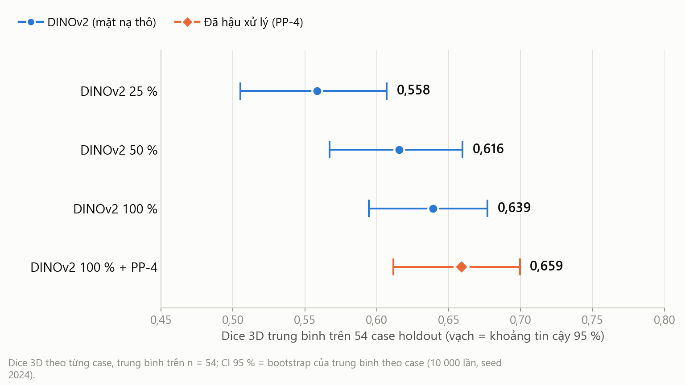
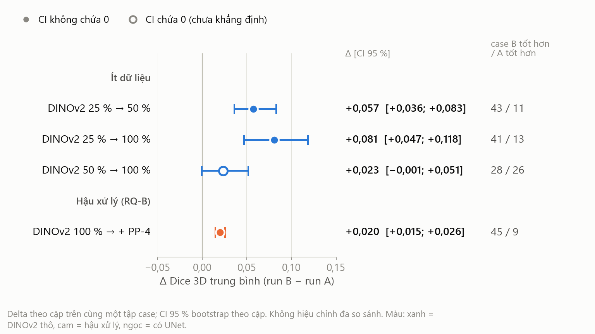
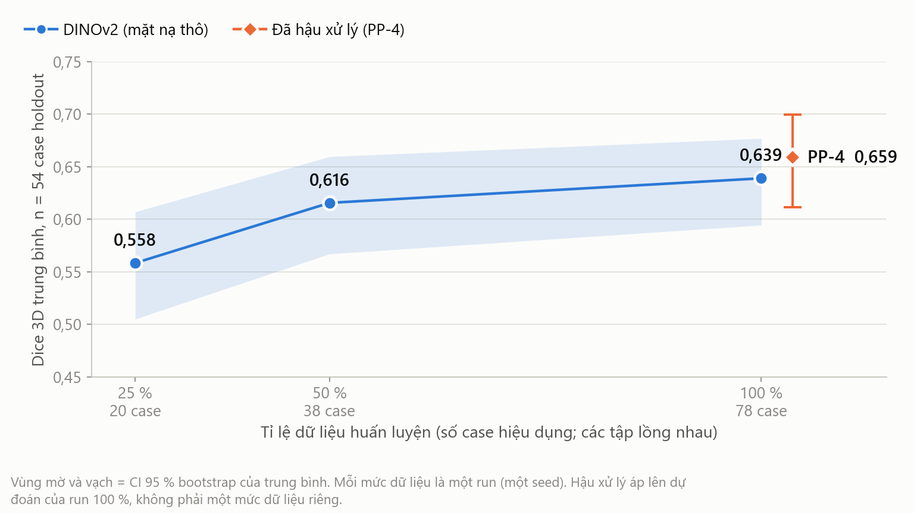
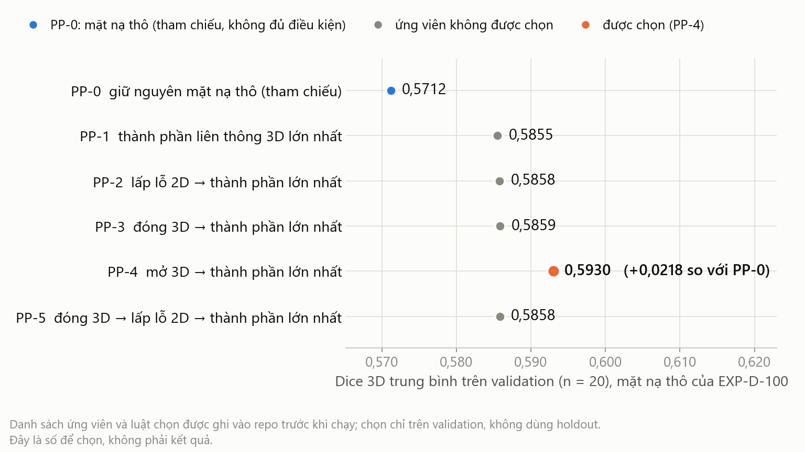
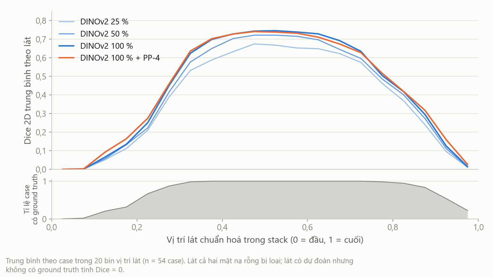
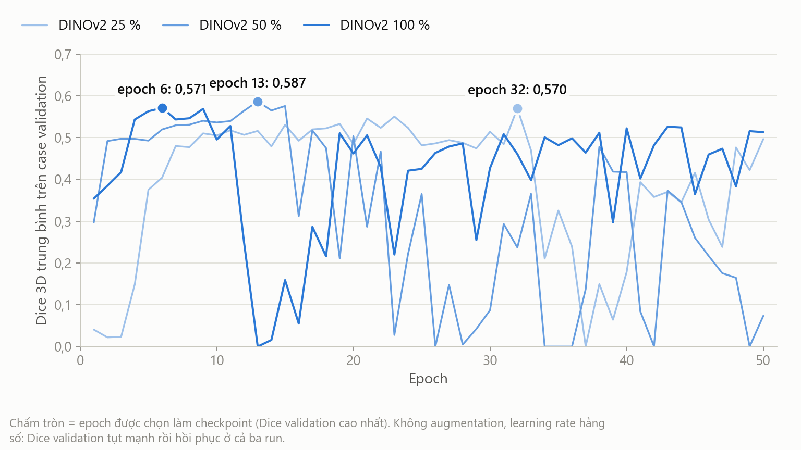

# Bảng kết quả trên tập holdout khoá (sinh tự động)

> Tệp này do `tools/report/build_report_assets.py` sinh từ artifact thí nghiệm. **Không sửa tay**: chạy lại lệnh trong `README.md` cùng thư mục. Chỉ có số **tổng hợp** (trung bình, trung vị, tứ phân vị, SD, CI bootstrap, delta cặp, số case); không có giá trị theo từng case, không có mã case, không có ảnh MRI hay mặt nạ.

| Mục | Giá trị |
| --- | --- |
| Quần thể | `final_holdout`, n = 54 case |
| Phiên bản chỉ số | `ml-eval-1.0.0` (Dice/IoU 3D theo từng case; voxel không bao giờ gộp giữa các case) |
| Khoảng tin cậy | CI 95 % = bootstrap phân vị của trung bình theo case, 10 000 lần lấy mẫu lại, seed 2024 |
| Chia dữ liệu đóng băng | `path_a_seed2024_dr002b_v1` — train danh nghĩa 80 (hiệu dụng 78), validation 20, holdout 54 |
| Hình học | đơn vị voxel; spacing là placeholder đơn vị (GATE-DATA-01 F2); RVE tính theo số voxel của ground truth |

## 1 · Kết quả chính (n = 54)

| Run | Mặt nạ | Case train | Dice 3D TB [CI 95 %] | Trung vị (Q1–Q3) | SD | IoU 3D TB [CI 95 %] | Dice TB theo lát | RVE TB / trung vị | FP voxel TB | FN voxel TB |
| --- | --- | --- | --- | --- | --- | --- | --- | --- | --- | --- |
| `EXP-D-025` DINOv2 25 % | THÔ | 20 | **0,5585** [0,5051; 0,6070] | 0,6040 (0,5231–0,6881) | 0,1945 | 0,4090 [0,3647; 0,4506] | 0,3940 | +19,21 % / +18,77 % | 114 977 | 88 546 |
| `EXP-D-050` DINOv2 50 % | THÔ | 38 | **0,6156** [0,5671; 0,6595] | 0,6675 (0,5813–0,7256) | 0,1743 | 0,4639 [0,4211; 0,5045] | 0,4213 | +12,47 % / +12,18 % | 95 113 | 80 342 |
| `EXP-D-100` DINOv2 100 % | THÔ | 78 | **0,6390** [0,5945; 0,6769] | 0,6788 (0,5786–0,7397) | 0,1541 | 0,4854 [0,4448; 0,5219] | 0,4264 | +14,95 % / +10,47 % | 95 990 | 74 753 |
| `EXP-D-PP` DINOv2 100 % + PP-4 | ĐÃ XỬ LÝ | 78 | **0,6590** [0,6117; 0,6995] | 0,7013 (0,5814–0,7664) | 0,1639 | 0,5099 [0,4660; 0,5499] | 0,4816 | +1,43 % / −4,98 % | 71 956 | 79 416 |

Mặt nạ THÔ = dự đoán gốc của mô hình (ngưỡng 0,5); ĐÃ XỬ LÝ = sau hình thái học đã đóng băng (GATE-IMG-01). RVE = (V dự đoán − V ground truth) / V ground truth, tính theo voxel. FP/FN theo voxel, trung bình theo case. SD là độ lệch chuẩn mẫu (ddof = 1).

## 2 · So sánh cặp từng case (run B − run A, Dice 3D)

| A → B | Câu hỏi | Δ TB [CI 95 %] | CI so với 0 | Case B tốt hơn / A tốt hơn | Nhãn so sánh |
| --- | --- | --- | --- | --- | --- |
| `EXP-D-025` → `EXP-D-050` | Ít dữ liệu | **+0,0572** [+0,0361; +0,0828] | không chứa 0 | 43 / 11 | COMPARABLE |
| `EXP-D-025` → `EXP-D-100` | Ít dữ liệu | **+0,0806** [+0,0469; +0,1183] | không chứa 0 | 41 / 13 | COMPARABLE |
| `EXP-D-050` → `EXP-D-100` | Ít dữ liệu | **+0,0234** [−0,0006; +0,0514] | chứa 0 | 28 / 26 | COMPARABLE |
| `EXP-D-100` → `EXP-D-PP` | Hậu xử lý (RQ-B) | **+0,0199** [+0,0145; +0,0257] | không chứa 0 | 45 / 9 | COMPARABLE |

4 CI **không** được hiệu chỉnh đa so sánh. Mỗi mức dữ liệu là một run, một seed: chênh lệch giữa các mức gồm cả phương sai giữa các lần chạy mà thiết kế này không tách ra được. Ứng dụng cố ý trả `comparable: false` cho cặp mặt nạ THÔ với ĐÃ XỬ LÝ; dòng hậu xử lý là phân tích ablation ngoại tuyến (spec `08` §2).

## 3 · Ít dữ liệu: Dice theo số case huấn luyện

## 4 · Tập độ nhạy (bỏ case nghi trùng bệnh nhân, DR-002b)

| Run | Dice TB, quần thể chính | Dice TB, tập độ nhạy | Chênh |
| --- | --- | --- | --- |
| `EXP-D-025` DINOv2 25 % | 0,5585 (n = 54) | 0,5549 (n = 53) | −0,0036 |
| `EXP-D-050` DINOv2 50 % | 0,6156 (n = 54) | 0,6128 (n = 53) | −0,0028 |
| `EXP-D-100` DINOv2 100 % | 0,6390 (n = 54) | 0,6375 (n = 53) | −0,0016 |
| `EXP-D-PP` DINOv2 100 % + PP-4 | 0,6590 (n = 54) | 0,6573 (n = 53) | −0,0017 |

| A → B | Δ TB chính [CI 95 %] | Δ TB độ nhạy [CI 95 %] |
| --- | --- | --- |
| `EXP-D-025` → `EXP-D-050` | +0,0572 [+0,0361; +0,0828] | +0,0579 [+0,0367; +0,0837] |
| `EXP-D-025` → `EXP-D-100` | +0,0806 [+0,0469; +0,1183] | +0,0826 [+0,0492; +0,1209] |
| `EXP-D-050` → `EXP-D-100` | +0,0234 [−0,0006; +0,0514] | +0,0247 [−0,00003; +0,0521] |
| `EXP-D-100` → `EXP-D-PP` | +0,0199 [+0,0145; +0,0257] | +0,0198 [+0,0145; +0,0257] |

## 5 · GATE-IMG-01: ứng viên hậu xử lý trên validation

Chọn chỉ bằng validation (n = 20), danh sách ứng viên và luật chọn được ghi vào repo trước khi chạy. Người thắng: **PP-4**, hơn PP-0 +0,0218 Dice; ngưỡng hoà 0,001; cấu hình đóng băng sha256 `c0a68cc7…`.

| Ứng viên | Thao tác theo thứ tự | Dice 3D TB | IoU 3D TB | RVE tuyệt đối TB (%) | Case trên / dưới PP-0 |
| --- | --- | --- | --- | --- | --- |
| PP-0 | giữ nguyên mặt nạ thô (tham chiếu) | 0,5712 | 0,4135 | 38,59 | — |
| PP-1 | thành phần liên thông 3D lớn nhất | 0,5855 | 0,4300 | 35,94 | 19 / 1 |
| PP-2 | lấp lỗ 2D → thành phần lớn nhất | 0,5858 | 0,4304 | 36,42 | 19 / 1 |
| PP-3 | đóng 3D → thành phần lớn nhất | 0,5859 | 0,4291 | 40,02 | 19 / 1 |
| **PP-4** | mở 3D → thành phần lớn nhất | 0,5930 | 0,4385 | 30,25 | 18 / 2 |
| PP-5 | đóng 3D → lấp lỗ 2D → thành phần lớn nhất | 0,5858 | 0,4292 | 40,58 | 17 / 3 |

Đây là số validation dùng để **chọn** cấu hình, không phải kết quả; 20 case validation cũng đã chọn checkpoint.

## 6 · Profile Dice theo vị trí lát

Dice 2D theo lát (ml-eval-1.0.0). Mỗi case: trung bình các lát áp dụng được trong bin; sau đó trung bình trên các case có ít nhất một lát áp dụng được. Lát mà cả hai mặt nạ rỗng bị loại (NOT_APPLICABLE). 20 bin trên vị trí lát đã chuẩn hoá [0, 1]; số case đóng góp từng bin nằm trong `results_aggregate.json` (`slice_profile.runs[].n_cases`). Ở hai đầu stack ground truth thường vắng nên Dice lát bằng 0 ngay cả khi mô hình chỉ sai nhẹ; hậu xử lý xoá bớt dự đoán thừa ở đó, và lát cả hai rỗng rời khỏi phép trung bình.

## 7 · Huấn luyện

| Run | Case train | Epoch | Epoch tốt nhất (Dice validation) | Dice validation epoch cuối | Dice validation thấp nhất | Số lần tụt mạnh | Giờ huấn luyện (tổng các epoch) |
| --- | --- | --- | --- | --- | --- | --- | --- |
| `EXP-D-025` DINOv2 25 % | 20 | 50/50 | 32 (0,5703) | 0,4965 | 0,0000 | 4 | 2,7 |
| `EXP-D-050` DINOv2 50 % | 38 | 50/50 | 13 (0,5868) | 0,0734 | 0,0000 | 9 | 3,3 |
| `EXP-D-100` DINOv2 100 % | 78 | 50/50 | 6 (0,5712) | 0,5129 | 0,0000 | 8 | 6,8 |

Dice validation là trung bình 3D trên 20 case validation, chỉ dùng để chọn checkpoint. "Tụt mạnh" = epoch có Dice validation thấp hơn epoch trước ≥ 0,10. EXP-D-PP không huấn luyện (hậu xử lý dự đoán của EXP-D-100).

## 8 · Nguồn gốc

| Run | Checkpoint best.pt (sha256) | Mã chấm điểm (git) |
| --- | --- | --- |
| `EXP-D-025` | `8d97b8fd…68a28` | `git:f08968ab` |
| `EXP-D-050` | `63fcb7f9…800f2` | `git:f08968ab` |
| `EXP-D-100` | `58152720…351fc` | `git:f08968ab` |
| `EXP-D-PP` | `58152720…351fc` | `git:f08968ab` |
